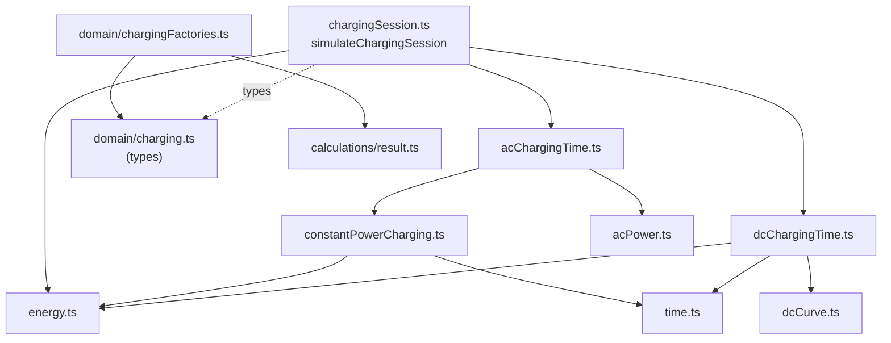
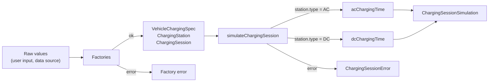

# Charging module: overview and architecture

## Purpose

The charging module models how an electric vehicle charges at a charging station and computes
the outcome of a charging session: how long it takes, how much energy is stored and where the
state of charge (SoC) ends up.

It has two responsibilities:

1. **Domain model** — types describing the vehicle's charging capabilities, charging stations
   and sessions, plus factories that turn raw, untrusted values into validated domain objects.
2. **Simulation engine** — pure functions that compute energy, power and time for AC and DC
   charging, and an orchestrating function that simulates a complete session.

The engine is **UI-independent**. It has no dependency on React, Next.js, the browser, I/O,
time or randomness: every function is synchronous, deterministic and side-effect free. It can be
called from server code, client components, scripts or tests in exactly the same way.

## Scope of milestone M0.1

Implemented:

- Domain types for AC and DC vehicle capabilities, AC and DC stations, charging curves and
  sessions with two termination conditions (target SoC, duration).
- Factories with typed validation errors for charging curves, AC and DC capabilities, and AC and
  DC stations.
- Energy from an SoC change, constant-power charging time, effective AC power from vehicle and
  station limits and phases, DC charging-curve interpolation, DC charging time by numerical
  integration.
- `simulateChargingSession`, which selects AC or DC charging from the station type and handles
  target-SoC and duration sessions, including a battery that fills before the duration elapses.

Explicitly **not** implemented (see [limitations](limitations.md)):

- Charging losses, temperature, battery ageing, preconditioning, AC tapering near full.
- Voltage and current modelling (`maxCurrentA` is validated but unused).
- Costs, multi-stop trip planning, station power sharing.
- Integration with vehicle data (OpenEV Data) or any UI. The landing page in `src/app/` does not
  use the module.

## Public entry point

The intended entry point for application features is
[`simulateChargingSession`](../../src/calculations/charging/chargingSession.ts):

```ts
simulateChargingSession({ vehicle, station, session })
  : CalculationResult<ChargingSessionSimulation, ChargingSessionError>
```

Callers interact with it in three steps:

1. Build validated domain values with the [factories](domain-model.md#factories)
   (`createACChargingCapability`, `createDCChargingCapability`, `createACChargingStation`,
   `createDCChargingStation`), handling their errors at the point where raw data enters.
2. Assemble a `VehicleChargingSpec` and a `ChargingSession` and call `simulateChargingSession`.
3. Branch on `result.ok`: read the simulation, or handle the typed error by its `type`.

The lower-level calculation functions are also exported and usable directly. There is no barrel
(`index.ts`); modules are imported by path through the `@/` alias (mapped to `src/`). See
[Public API](public-api.md) for contracts and examples.

## Source organization

```text
src/
├── domain/
│   ├── charging.ts             Domain types (raw and validated)
│   ├── chargingErrors.ts       Factory validation error types
│   └── chargingFactories.ts    Factories: raw input -> validated domain value
└── calculations/
    ├── result.ts               CalculationResult<T, E>
    └── charging/
        ├── energy.ts                 Energy for an SoC change
        ├── time.ts                   Time for an energy at constant power
        ├── constantPowerCharging.ts  SoC change at constant power
        ├── acPower.ts                Effective AC power (vehicle x station x phases)
        ├── acChargingTime.ts         AC charging time
        ├── dcCurve.ts                Charging-curve interpolation
        ├── dcChargingTime.ts         DC charging time (numerical integration)
        ├── chargingSession.ts        Session simulation (orchestration)
        └── error.ts                  Calculation and session error types
```

## Layers

| Layer         | Files                                                                                               | Responsibility                                                      |
| ------------- | --------------------------------------------------------------------------------------------------- | ------------------------------------------------------------------- |
| Domain model  | `domain/charging.ts`                                                                                | Shapes of vehicles, stations, curves and sessions. No behavior.     |
| Factories     | `domain/chargingFactories.ts`, `domain/chargingErrors.ts`                                           | Validate raw values; establish invariants of domain objects.        |
| Calculations  | `energy`, `time`, `constantPowerCharging`, `acPower`, `acChargingTime`, `dcCurve`, `dcChargingTime` | One physical quantity each; validate their own numeric inputs.      |
| Orchestration | `chargingSession.ts`                                                                                | Selects AC or DC, applies termination rules, inverts time into SoC. |

Dependencies point downward only:



Calculations import domain **types** only; they never call the factories. The factories import
`CalculationResult` from `calculations/result.ts` (see the open question on this dependency
direction in [limitations](limitations.md#open-questions-and-technical-debt)).

## Data flow of a session



The session function builds a _charging-time function_ `(fromSoc, toSoc) => hours` bound to the
vehicle and station, then uses it once (target SoC) or repeatedly by bisection (duration).

## Design rationale

**Errors as values.** Every fallible function returns `CalculationResult<T, E>`, a discriminated
union of `{ ok: true, value }` and `{ ok: false, error }`. Invalid user input is an expected
outcome in a comparison tool, not an exceptional one. Typed errors force callers to handle
failure and let them map each `error.type` to a message. Nothing in the module throws for invalid
numeric input.

**Raw vs validated types, and validation in two places.** Factories convert raw values into
domain objects at the boundary. The validated types are not branded, however: an
`ACChargingStation` written as an object literal type-checks without passing through a factory.
Public calculation functions therefore validate the numeric inputs that would otherwise yield
`NaN`, `Infinity` or silently wrong results (battery capacity, SoC, power limits, AC phases).
Structural invariants that only the factories check, such as charging-curve ordering, are relied
upon rather than re-checked. See
[factory vs calculation validation](domain-model.md#factory-level-vs-calculation-level-validation).

**Limits validated individually before combining.** Effective power is a `Math.min` of vehicle
and station limits. `Math.min(Infinity, 11)` is `11`, so an invalid limit would be hidden by the
valid one. Each limit is checked on its own first.

**Station type drives AC/DC selection.** `ChargingStation` is a discriminated union on `type`.
Every vehicle has an AC capability; DC is optional. A DC station with a vehicle lacking DC yields
`dcChargingNotSupported` instead of a fallback.

**One forward model, inverted for duration sessions.** Duration sessions do not have a separate
time-stepping simulator. They invert the same forward charging-time function by bisection, so a
duration session and a target-SoC session always agree: charging for the time returned by a
target-SoC session reaches that target (tests verify this).

**Simple, deterministic numerics.** DC time uses the midpoint rule with a fixed maximum step of
0.1 SoC points. It is easy to reason about, exact on flat curve segments and accurate to well
under a second on realistic curves. Accuracy limits are documented in
[limitations](limitations.md#numerical-accuracy).
