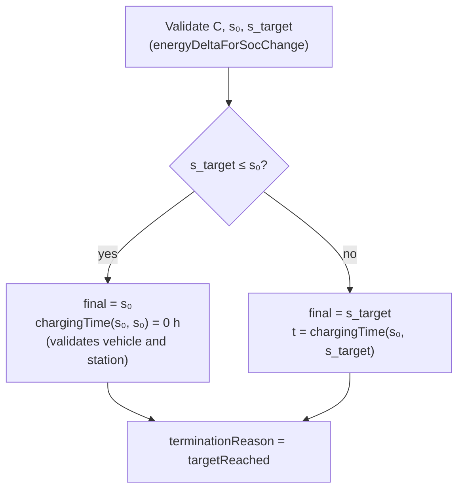
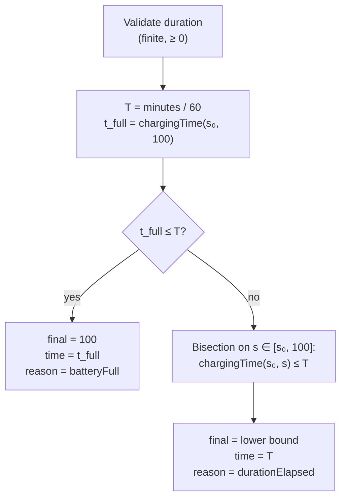

# Charging calculation model

Notation used on this page:

| Symbol    | Meaning                 | Unit |
| --------- | ----------------------- | ---- |
| C         | Usable battery capacity | kWh  |
| s, s₀, s₁ | SoC; start SoC; end SoC | %    |
| ΔE        | Energy stored           | kWh  |
| P         | Power                   | kW   |
| t         | Time                    | h    |

## Energy from an SoC change

[`energyDeltaForSocChange`](../../src/calculations/charging/energy.ts)

```text
ΔE = (s₁ − s₀) / 100 × C
```

Validates `C` (finite, > 0) and both SoC values (finite, in [0, 100]). It does not enforce
`s₀ ≤ s₁`, so the result is negative for a decreasing SoC. Callers that need an ordered range
check it themselves.

## Time at constant power

[`timeForEnergyAtConstantPower`](../../src/calculations/charging/time.ts)

```text
t = ΔE / P
```

Requires `P` finite and > 0 and `ΔE` finite and ≥ 0. Every time computed by the module ends in
this function, so it is also the last guard against non-finite values reaching a result.

[`constantPowerChargingTime`](../../src/calculations/charging/constantPowerCharging.ts) combines
the two: it validates the SoC values and capacity, rejects `s₀ > s₁` (`invalidSocRange`), then
returns `ΔE / P`.

## AC charging

### Effective AC power

[`resolveEffectiveAcPower`](../../src/calculations/charging/acPower.ts) assumes each side's
power is spread evenly across its phases, and that only the phases both sides have can be used:

```text
P_AC = min(P_vehicle / n_vehicle, P_station / n_station) × min(n_vehicle, n_station)
```

| Vehicle         | Station         | Per-phase limits | Shared phases | P_AC    |
| --------------- | --------------- | ---------------- | ------------- | ------- |
| 11 kW, 3 phases | 22 kW, 3 phases | min(3.67, 7.33)  | 3             | 11 kW   |
| 7.4 kW, 1 phase | 11 kW, 3 phases | min(7.4, 3.67)   | 1             | 3.67 kW |
| 11 kW, 3 phases | 7.4 kW, 1 phase | min(3.67, 7.4)   | 1             | 3.67 kW |

This function returns a plain number and assumes validated inputs. Validation happens in
`acChargingTime`.

### AC charging time

[`acChargingTime`](../../src/calculations/charging/acChargingTime.ts) validates the vehicle and
station limits individually (power finite and > 0, phases integer in [1, 3]), then computes:

```text
t = ΔE / P_AC
```

AC power is constant over the whole SoC range; there is no taper near 100%.

## DC charging curve interpolation

[`powerAtSoc`](../../src/calculations/charging/dcCurve.ts) evaluates a curve with points
`(sᵢ, Pᵢ)`:

```text
P(s) = P₀                                                  if s ≤ s₀
P(s) = Pₙ                                                  if s ≥ sₙ
P(s) = Pᵢ + (Pᵢ₊₁ − Pᵢ) × (s − sᵢ) / (sᵢ₊₁ − sᵢ)           for sᵢ < s ≤ sᵢ₊₁
```

Outside the curve's SoC range the nearest endpoint power is held constant. Published curves often
cover only part of the range (for example 10–80%), and holding the endpoints avoids errors there.
The function rejects a non-finite SoC but deliberately accepts any finite SoC. It relies on the
factory for curve ordering; the lookup is a linear scan.

## DC charging time

[`dcChargingTime`](../../src/calculations/charging/dcChargingTime.ts) integrates time over
energy, with the curve power capped by both limits:

```text
P_eff(s) = min(P(s), P_vehicle,max, P_station,max)

t = ∫ dE / P_eff  =  C/100 × ∫[s₀, s₁] ds / P_eff(s)
```

Numerically, the SoC interval is split into `N` equal steps no wider than 0.1 points, and each
step is charged at the power at its midpoint (midpoint rule):

```text
N  = ceil((s₁ − s₀) / 0.1)
Δs = (s₁ − s₀) / N
t ≈ Σₖ₌₀..ₙ₋₁ (ΔE / N) / P_eff(s₀ + (k + ½) Δs)
```

A zero-width interval gives `N = 0` and `t = 0`, after the inputs have been validated.

Validation order: capacity and SoC values, then `s₀ ≤ s₁`, then each power limit individually,
then each step's power (through `timeForEnergyAtConstantPower`).

Accuracy:

- Steps that lie entirely within a constant-power stretch (flat curve segment or capped region)
  are exact.
- On sloped segments the midpoint rule underestimates the time, because `1/P` is convex. For a
  linear 200 → 50 kW curve over 0–80% on an 80 kWh battery (about 35.5 min), the error is about
  0.001 s.
- Extreme slopes are much less accurate; see
  [numerical accuracy](limitations.md#numerical-accuracy).

## Session simulation

[`simulateChargingSession`](../../src/calculations/charging/chargingSession.ts) first selects
the forward function from the station type and binds it to the vehicle:

- `"AC"`: `acChargingTime` with `vehicle.ac`.
- `"DC"`: `dcChargingTime` with `vehicle.dc`; `dcChargingNotSupported` if `vehicle.dc` is absent.

This yields `chargingTime(s₀, s₁) → hours`. Delivered energy is always `ΔE` between the initial and
final SoC, which is energy stored in the battery, not energy drawn from the grid.

### Target SoC



A target at or below the initial SoC is "already reached": zero time and zero energy. It is not an
error. The forward function is still called with an empty interval so that an invalid vehicle or
station is reported consistently whatever the target.

### Duration



`t_full` is computed for every duration, including zero, so the inputs are always validated. The
bisection relies on the forward time increasing strictly with the end SoC, which holds because
every power is positive. It stops when the bracket is narrower than 10⁻⁶ SoC points (at most 27
halvings of a 100-point span; capped at 50 iterations). It returns the **lower** bound, so the
forward time to the reported SoC never exceeds the duration.

When the battery is full first, `chargingTimeHours` is shorter than the requested duration and
`terminationReason` is `batteryFull`. An initial SoC of 100% with any duration gives
`batteryFull` with zero time. A zero duration below 100% gives `durationElapsed` with no change.
