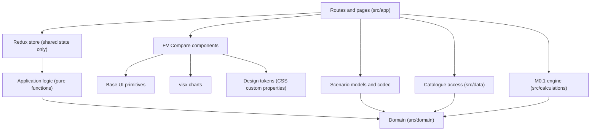

# ADR 0001 — Frontend architecture

| Field   | Value                                                                                                                                      |
| ------- | ------------------------------------------------------------------------------------------------------------------------------------------ |
| Status  | Accepted                                                                                                                                   |
| Date    | 2026-11-03                                                                                                                                 |
| Applies | Milestone M0.2 onwards: every frontend change                                                                                              |
| Related | [First vertical slice](../milestones/m0.2-first-vertical-slice.md) (M0.2)                                                                  |
| Revised | 2026-11-03: `react-redux` approved; open questions before the slice listed                                                                 |
| Revised | 2026-11-03: effective DC power API extension, URL and history policy, and the slice's DC simulation UX and SoC rules approved and recorded |
| Revised | 2026-11-08: origin context in the URL approved by the product owner (open question 6); repository state brought up to date                 |

This record formalises decisions that were already discussed and approved. It does not
introduce new ones. Wherever a detail has not been decided, it is listed under
[Open questions](#9-open-questions) and must not be treated as settled.

## 1. Context

- **M0.1 is complete.** A UI-independent charging domain model and simulation engine live in
  `src/domain/` and `src/calculations/` ([charging docs](../charging/README.md)). It is pure,
  synchronous and deterministic, and reports invalid input as typed errors
  (`CalculationResult<T, E>`).
- **The UX of M0.2 is consolidated**: high-level flows, desktop wireframes for Discovery,
  Vehicle Analysis and Comparison.
- **Livrea Consolidated is the selected visual identity** of the product.
- **When this record was written, the web app was still the bootstrap landing page**
  (`src/app/`), with no frontend feature, styling system, state management or chart. The
  [first vertical slice](../milestones/m0.2-first-vertical-slice.md) is now being implemented;
  its status is tracked in the slice and in the [README](../../README.md), not here. The
  "In the repository today" column below records only which parts of the stack are present.

Authoritative sources. This ADR does not override them; where it seems to, the source wins and
the conflict must be reported.

| Concern              | Source                                                                                                                                                                                                                                                                                                                              |
| -------------------- | ----------------------------------------------------------------------------------------------------------------------------------------------------------------------------------------------------------------------------------------------------------------------------------------------------------------------------------- |
| Product requirements | [Product Vision](../product-vision.md)                                                                                                                                                                                                                                                                                              |
| UX                   | [UX Design Principles](../ux/design-principles.md), [user flows](../ux/user-flow-overview.md), consolidated wireframes ([Discovery](../ux/wireframes/consolidated-iteration-1/README.md), [Vehicle Analysis](../ux/wireframes/vehicle-analysis-iteration-1/README.md), [Comparison](../ux/wireframes/vehicle-comparison/README.md)) |
| Visual identity      | [Livrea Consolidated](../ux/visual-identity/livrea-consolidated/README.md), [photography](../ux/visual-identity/photography.md)                                                                                                                                                                                                     |
| Charging engine      | [Public API](../charging/public-api.md), [domain model](../charging/domain-model.md), [limitations](../charging/limitations.md)                                                                                                                                                                                                     |

## 2. Technology stack

| Area                     | Technology                        | In the repository today (2026-11-08)                                |
| ------------------------ | --------------------------------- | ------------------------------------------------------------------- |
| Framework                | Next.js 16 (App Router)           | Installed (16.x)                                                    |
| UI                       | React 19                          | Installed (19.2.x)                                                  |
| Language                 | TypeScript, `strict`              | Installed (6.x)                                                     |
| Accessible primitives    | Base UI                           | Installed (`@base-ui/react` 1.x): Slider, RadioGroup                |
| Styling                  | CSS Modules                       | In use                                                              |
| Design tokens            | CSS Custom Properties             | Defined in `src/styles/tokens.css`                                  |
| Design system            | Proprietary EV Compare components | First components in `src/components/`                               |
| Technical charts         | visx                              | `@visx/scale`, `@visx/shape`, `@visx/group`, `@visx/axis` installed |
| Shared application state | Redux Toolkit, with `react-redux` | Not installed                                                       |
| Shareable scenarios      | URL                               | Search scenario, origin context, DC simulation scenario             |
| Calculation engine       | M0.1, independent of the frontend | Implemented, with the effective DC power extension                  |
| Tests (existing)         | Vitest                            | Installed, Node environment                                         |

Rules:

- Existing dependencies stay. ESLint 9 and TypeScript 6 stay for the reasons given in the
  [README](../../README.md#bootstrap-choices).
- No library beyond this table is introduced, and no part of the stack is replaced. A need that
  the stack cannot meet is reported, not solved by adding a dependency.
- Packages are installed in the implementation session that first needs them, not in advance.
- The strategy for UI component tests and end-to-end tests is **not defined** (see
  [Testing](#7-testing)).

Packaging notes to verify at installation time (they do not change the stack):

- Redux Toolkit is used from React through its official binding, `react-redux`, which is part of
  the approved Redux Toolkit decision. Both are installed together, only when Redux is actually
  introduced (see [Decision 6](#decision-6--redux-toolkit)); approving the binding does not mean
  creating a store or slices in advance.
- visx is distributed as separate `@visx/*` packages; install only those a chart uses.
- Check the current npm package name of Base UI and the declared React 19 support of Base UI,
  visx and Redux Toolkit against the installed React version.

## 3. Separation of responsibilities

| Concern                                 | Location                                           | Must not depend on                                |
| --------------------------------------- | -------------------------------------------------- | ------------------------------------------------- |
| Domain models and rules                 | `src/domain/` (existing)                           | React, Next.js, Redux, visx, browser APIs         |
| Calculation engines                     | `src/calculations/` (existing, M0.1)               | React, Next.js, Redux, visx, browser APIs         |
| Vehicle catalogue access                | `src/data/`                                        | React components, Redux                           |
| Application logic and state transitions | Pure TypeScript functions; location open           | React, Redux (testable without either)            |
| Shared state                            | Redux Toolkit store; location open                 | Domain rules implemented inside reducers          |
| Routing and scenario serialisation      | Routes in `src/app/`; scenario codec location open | Codec: React, Redux                               |
| Presentation components                 | `src/components/`                                  | Calculation internals; arbitrary colour values    |
| Design tokens and styling               | Central CSS Custom Properties + CSS Modules        | Values duplicated in components                   |
| Technical visualisations                | visx-based components                              | Mathematical logic (they receive computed series) |

Dependencies point from the UI towards the domain, never the reverse:



Constraints:

- **The M0.1 engine stays independent** of React, Redux, Next.js, visx and every other frontend
  technology. Frontend needs never justify changing engine behaviour, and the frontend never
  reimplements engine mathematics. The one approved extension of its public API is described in
  [Extension of the M0.1 public API](#extension-of-the-m01-public-api-effective-dc-power); other
  values the engine does not expose are handled as described in
  [open question 3](#9-open-questions).
- **Interface-only constraints stay out of the engine.** Rules that exist only because of how a
  control works (SoC granularity, controls that keep the initial SoC from passing the final one)
  belong to the UI and to the scenario models. M0.1 invariants and validation are not tightened to
  enforce them.
- **Selection logic is testable without Redux.** Rules that change the comparison selection are
  plain functions; a reducer may call them, not contain them.
- **Raw data enters through the M0.1 factories**, as [limitations](../charging/limitations.md#constraints-for-future-extensions)
  requires for external data. Catalogue data is validated where it is loaded, not in components.
- **No speculative layers.** Do not add services, repositories, adapters or abstraction layers for
  features that do not exist. A layer is introduced by the first feature that needs it.

The table names the directories that exist. Locations marked "open" are decided
by the first implementation that needs them and recorded in that change.

### Extension of the M0.1 public API: effective DC power

**Approved (2026-11-03).** The M0.1 public API gains one pure function that returns the
**effective DC power at a given SoC**: the vehicle's curve power at that SoC (as `powerAtSoc`
computes it) capped by the vehicle's DC maximum (`DCChargingCapability.maxPowerKw`) and by the
station's maximum (`DCChargingStation.maxPowerKw`). It is the power `dcChargingTime` already
integrates at each step. M0.1 models no other DC limit (no voltage or current model,
[limitations](../charging/limitations.md)); if the engine gains one, the function follows it.

It exists so the frontend can draw the power actually received (first vertical slice: DC
simulation chart and Ricarica preview) without reimplementing the cap.

Requirements:

- It belongs to `src/calculations/` (domain and calculation layer), never to frontend code.
- It reuses the existing logic: `powerAtSoc` for the curve and the cap that `dcChargingTime`
  applies. There is one implementation of the cap, not a second copy. If `dcChargingTime` is
  refactored to call the new function, its results and its existing tests stay unchanged.
- It takes the validated domain types and follows the existing conventions: one input object
  with named, unit-suffixed fields; `CalculationResult` with typed errors; no exceptions for
  invalid input.
- It is pure, synchronous and deterministic.
- Existing public functions, types and results are unchanged (backward compatible).
- It has Vitest tests covering at least: power limited by the curve alone, power limited by the
  vehicle maximum, power limited by the station maximum, and invalid input.
- It is documented in [`docs/charging/public-api.md`](../charging/public-api.md) in the change
  that adds it.

Left to the implementation, within the requirements above: name, module, exact signature and
input shape, which errors are returned and in which order, and behaviour at SoC values outside
the curve's range or outside [0, 100]. The choices are recorded in the public API documentation.

Not approved by this decision: a limiting factor for a session or a SoC, an energy-over-time
series, range estimates, or any other function the first vertical slice does not need. They stay
under [open question 3](#9-open-questions).

## 4. State management

### Decision 1 — Shareable scenarios in the URL

EV Compare can share and fully rebuild, from a URL alone:

- searches, with their criteria and preferences;
- comparisons, with the selected vehicles and the criteria applied;
- technical simulations, with every parameter needed to reproduce them.

Constraints:

- Each scenario has a **TypeScript model independent of the frontend framework**.
- Scenarios are **serialisable, validated and rebuildable** without any previous browser state
  (no `localStorage`, history state or in-memory store is needed to open a shared URL).
- Parsing untrusted URL input returns a validated scenario or a typed error, following the
  repository's errors-as-values convention. A malformed URL never crashes the page.
- Serialising and parsing **round-trip**: parsing a serialised scenario yields an equal scenario.
- The representation can **evolve** without needlessly breaking existing URLs.
- Vehicles are referenced by **stable identifiers**, so a URL keeps pointing to the same vehicle.

Not decided: the concrete URL format (parameter names, encoding, compression, versioning
mechanism) and the behaviour for partially invalid scenarios. Do not fix a definitive URL schema
before the scenarios that need it exist.

### Decision 2 — Reactive updates

Changes to criteria and parameters update results automatically when the computational cost
allows it. There is no mandatory confirmation step for operations that can update directly.

Five events are distinct and need not happen at the same time:

| Event                       | Meaning                                                            |
| --------------------------- | ------------------------------------------------------------------ |
| Temporary interaction state | A value while the user is still interacting (slider being dragged) |
| Committed scenario state    | The scenario value the product considers current                   |
| Result update               | Results recomputed from the inputs                                 |
| URL update                  | The URL rewritten to represent the committed scenario              |
| Browser history update      | A new history entry, as opposed to replacing the current one       |

Example: dragging a slider may update results continuously, but must not create a history entry
for every intermediate value.

**Policy (approved 2026-11-03):**

| Event                                  | Results                           | URL                               | Browser history |
| -------------------------------------- | --------------------------------- | --------------------------------- | --------------- |
| Dragging a slider (for example SoC)    | Updated during the interaction    | Not updated while dragging        | No new entry    |
| Releasing the slider                   | Keep the value reached            | Updated to the committed value    | `replace`       |
| Selecting a discrete option (station)  | Updated immediately               | Updated                           | `replace`       |
| Navigating between pages or activities | Scenario of the destination shown | Navigation to the destination URL | `push`          |

Principles:

1. The committed scenario is the one the URL represents.
2. Values during a drag are temporary interaction state, owned by local React state.
3. During the interaction, results may be derived from the temporary values.
4. When the interaction ends, the new scenario is committed to the URL.
5. Changing parameters never creates a history entry per change.
6. A shared URL rebuilds the scenario without any session memory (see
   [Decision 1](#decision-1--shareable-scenarios-in-the-url)).
7. Navigation between Discovery, Vehicle Analysis and the DC simulation preserves the context
   each needs (see [Decision 4](#decision-4--navigation-continuity)).

Applying the policy to inputs the table does not name:

- A slider change made in one step, without dragging (a keyboard step, a click on the track), is
  committed at once, like a release: URL updated with `replace`.
- Continuous text input, such as the search query, follows principle 5: no history entry per
  keystroke. Whether the URL is rewritten on each keystroke or after a pause is an
  implementation choice.

Left to the implementation: the concrete synchronisation mechanism (router calls, how local
state is reset when the URL changes from outside, for example on Back), provided it follows the
table and the principles.

### Decision 3 — Comparison selection

The selection preserves vehicle identity, selection order, visual slots, and stable colours and
markers while it changes. Its logical structure is equivalent to:

```ts
type ComparisonEntry = {
  vehicleId: string;
  slot: number;
};

type ComparisonSelection = ComparisonEntry[];
```

- Array order is the selection order.
- `slot` is the visual identity of the vehicle.

Rules:

1. A new vehicle receives the first free slot.
2. Removing a vehicle frees its slot.
3. The remaining vehicles are not reassigned.
4. An explicit replacement keeps the replaced vehicle's slot.
5. Reordering, if offered, does not change slots.
6. Serialising the scenario rebuilds the selection faithfully, including order and slots. Since
   order and slot diverge after removals, both are part of the serialised form.

Colour and marker shape are **derived** from the slot and the design tokens. In Livrea
Consolidated the slots are 1 Cobalto, 2 Mandarino, 3 Smeraldo, 4 Magenta, and the marker shapes
in slot order are circle, square, triangle, diamond (`_source/livrea-consolidated.mjs`). They are
never stored as independent data.

Not decided: more than four vehicles; behaviour when the selection is full; replacing a vehicle
with one that is already selected; the numeric base of `slot`.

### Decision 4 — Navigation continuity

Preserved: the current scenario; the origin context; what is needed to return to the previous
activity; the scroll position when appropriate.

Not preserved indiscriminately: tooltips, hover, temporary editors, open menus and other
transient visual states.

Constraints:

- Use native browser and Next.js behaviour (history, scroll restoration, links) where it is
  sufficient. No additional persistence (storage, server sessions) without a demonstrated need.
- A page opened directly from a URL works on its own, without any previous navigation context.
  The wireframes define this case (for example "‹ Cerca" instead of "‹ Risultati" in Vehicle
  Analysis).
- The return path is a product behaviour (the context bar of the wireframes), not only the
  browser's Back button; both must behave consistently.

Origin context representation: the URL, approved by the product owner on 2026-11-08 (open
question 6).

### Decision 5 — Derived data and calculations

- **Inputs are the source of truth** for calculated results. M0.1 results are derived from the
  inputs and not duplicated in shared state.
- Prefer direct calculation when it is fast enough. The engine's own cost estimate
  ([limitations](../charging/limitations.md#numerical-accuracy)) is negligible for interactive use.
- Memoisation, caches or Web Workers are introduced only with a concrete, **measured** reason.
  No preventive complex cache.
- A cache of remote data (future vehicle data source) is separate from the handling of
  mathematical results.

### Decision 6 — Redux Toolkit

Redux Toolkit manages shared application state, for predictable and traceable transitions,
organised state, testability and shared conventions.

Constraints:

- Redux does not duplicate the scenarios represented in the URL.
- Each piece of information has **one authoritative source** (table below).
- Domain rules stay independent of reducers.
- State that is purely local stays in React.
- Calculated results are not stored globally without need.
- The store is not a general container for every piece of application information.
- With the App Router, follow the official Redux Toolkit guidance: one store per request, created
  in a client component, never a module-level singleton shared across requests.

Sources of truth known today:

| Information                                       | Authoritative source                 |
| ------------------------------------------------- | ------------------------------------ |
| Committed search, comparison, simulation scenario | URL                                  |
| Temporary interaction values                      | Local React state                    |
| Transient UI (tooltip, hover, menus, editors)     | Local React state; not preserved     |
| Calculated results                                | Derived from inputs; not stored      |
| Vehicle catalogue                                 | Catalogue data access (`src/data/`)  |
| Visual identity of a vehicle                      | Derived from its slot and the tokens |

Not decided: the slice structure of the store, and which state is owned by Redux at all (see
[open questions](#9-open-questions)). Do not design the full set of slices in advance.

## 5. Design system

### Tokens

Livrea Consolidated is the approved baseline. Its tokens are CSS Custom Properties defined in one
central place and covering: semantic colours (the four families: interface, your scenario,
vehicles, signals), Schibsted Grotesk typography, spacing, borders and radii, interactive states,
vehicle colours, marker shapes, data provenance indicators.

- Components use tokens; they do not repeat raw values.
- The colour rules of Livrea Consolidated apply to code as they do to the SVGs: a colour from one
  family never does another family's job; a vehicle colour always appears with its number or
  marker shape; yellow marks scenario parameters and their effects, never view options,
  navigation or warnings.
- Livrea Consolidated applies yellow intensity B and keeps A as a fallback; the token structure
  should not make that switch harder.
- Desktop (1440 px) is the only designed width; mobile and dark theme are not designed.

### Primitives and styling

- Base UI provides interactive accessible primitives (sliders, toggle groups, menus, dialogs,
  tooltips…).
- Styling is CSS Modules consuming the tokens.

### Application components

EV Compare builds its own components that represent product concepts directly, for example
`VehicleCard`, `VehicleIdentityBadge`, `CriterionEditor`, `DataProvenanceTag`,
`ComparisonTable`, `ChargingCurveChart`. These are examples, not a catalogue to build now.

Components take **semantic** properties (a slot, a provenance kind, a vehicle) and decide colour,
border, icon and shape themselves. Callers do not repeatedly decide presentation details. For
instance, a provenance tag receives `costruttore`, `stima` or `calcolo` and renders the matching
symbol (■, ○, ◆) and label.

The provenance kind says where a value comes from. Whether the value is real or illustrative is a
separate property, not a fourth kind; the first vertical slice states how its fictional catalogue
expresses it ([Data](../milestones/m0.2-first-vertical-slice.md#4-data)).

### Charts

visx is used for technical visualisations. Charts preserve the Livrea Consolidated principles:

- declared curve points are distinguishable from linear interpolation between them;
- the station limit is represented (dashed line with plate, hatched region above it, unreachable
  part of the curve dotted);
- the power actually received comes from the engine's effective DC power
  ([extension](#extension-of-the-m01-public-api-effective-dc-power)), never from a cap recomputed
  in the chart;
- markers and colours come from the vehicle slot;
- labels and technical values are correct, with units;
- interactions are accessible.

Mathematical logic is not coupled to chart components: charts receive series computed elsewhere
(engine or pure functions) and only map them to pixels.

## 6. Alternatives considered

These are the reasons the approved options were preferred. They are not a full record of the
discussion.

| Alternative                                              | Why it was not adopted                                                                                                                    |
| -------------------------------------------------------- | ----------------------------------------------------------------------------------------------------------------------------------------- |
| URL and React state only, no shared store                | Less organised and traceable shared state as features grow; the URL still owns scenarios, so the cost of Redux stays bounded              |
| Redux as the single store of everything, URL as a mirror | Two sources of truth for scenarios; shared links would depend on synchronisation code                                                     |
| Storing engine results in the store or a cache           | Duplicates data derivable from inputs; the engine is cheap enough to recompute                                                            |
| Persisting navigation state in browser storage           | Not needed when the URL and native history suffice; would hide whether a shared URL is self-sufficient                                    |
| A pre-styled component library                           | Livrea Consolidated is a proprietary identity; Base UI is unstyled and keeps accessibility without imposing a look                        |
| Utility-class or runtime CSS-in-JS styling               | CSS Modules with custom properties keep tokens in plain CSS, scoped per component, without a styling runtime                              |
| High-level chart libraries with prebuilt chart types     | The charging chart needs precise, non-standard semantics (declared points, interpolation, station limit); visx gives low-level primitives |

## 7. Testing

- Vitest stays the test runner for domain, calculations, scenario codecs and selection logic.
  These are plain TypeScript and run in the existing Node environment.
- Every new pure module (scenario model and codec, selection rules, catalogue validation) has
  unit tests, mirroring the source layout as today.
- **Not defined:** how UI components and end-to-end flows are tested, and with which tools. No
  test library is added until that strategy is decided.

## 8. Consequences and trade-offs

- Two state mechanisms (URL and Redux) need a clear ownership rule per piece of information;
  the table in Decision 6 is the starting point and must be extended, not bypassed.
- Keeping results derived means recomputation on every relevant change. This is acceptable with
  M0.1's measured cost; it must be revisited with measurements if heavier models arrive.
- Proprietary components on unstyled primitives cost more initial work than a styled library,
  in exchange for an identity that follows Livrea Consolidated exactly.
- visx requires building axes, legends and interactions explicitly, including accessibility.
- An evolvable URL format must be designed with compatibility in mind from the first scenario,
  even though its concrete schema is deferred.
- Charts and components that need values the engine does not expose (see open question 3) cannot
  compute them in the UI without duplicating engine logic. Effective DC power is now an approved
  engine extension; the other values still need a decision before any UI uses them.
- The URL is rewritten after each committed change but not during a drag, so for the length of a
  drag the displayed results are ahead of the URL. A URL copied mid-drag holds the last committed
  scenario.

## 9. Open questions

1. **`react-redux`: resolved.** Approved as the official binding that integrates Redux Toolkit
   with React ([Technology stack](#2-technology-stack)). It is installed only when Redux is
   introduced. The numbering of the remaining questions is kept because other documents refer
   to it.
2. **Store scope.** Which state Redux owns. In particular, where the comparison selection lives
   while the user is outside the comparison view (the comparison URL owns it inside the view).
3. **Values not exposed by M0.1: partially resolved.** The wireframes show the effective power at
   a SoC (curve capped by vehicle and station maximum), the limiting factor of a session and an
   energy-over-time series. M0.1 applies the cap inside `dcChargingTime` and exports only
   `powerAtSoc` (uncapped).

   Orientation (approved): extending the M0.1 public API is admissible with pure functions that
   are backward compatible and tested, when they expose information that already belongs to the
   calculation logic. Duplicating the engine's mathematics in the frontend is not acceptable.

   Resolved: the **effective DC power at a SoC** is exposed through a new function
   ([Extension of the M0.1 public API](#extension-of-the-m01-public-api-effective-dc-power));
   its exact contract is defined by the implementation.

   Still open: whether and how the engine exposes the limiting factor and an energy-over-time
   series. Neither is needed by the first vertical slice; no function for them is authorised.

4. **URL format**: encoding, versioning, handling of partially invalid scenarios.
5. **History policy: resolved.** Commit points, URL rewriting and push versus replace are set by
   the policy in [Decision 2](#decision-2--reactive-updates). Only the synchronisation mechanism
   is left to the implementation.
6. **Origin context representation: resolved.** Approved by the product owner on 2026-11-08,
   during increment 2 of the first vertical slice. The URL carries it: a vehicle page
   opened from Discovery has the origin parameter and the search scenario
   (`/veicoli/<id>?da=cerca&q=…`); the canonical vehicle URL without them is direct access
   ("‹ Cerca"). Links to the simulator forward the same parameters. Model and codec:
   `src/scenarios/originContext.ts`. Parameter names are not a definitive URL schema (question 4).
7. **Comparison capacity** beyond four vehicles and the behaviour of a full selection.
8. **UI component and end-to-end test strategy** and tools.
9. **Token organisation**: file location, naming (Livrea names such as Inchiostro, or role
   names), and how the A/B yellow intensity is expressed.
10. **Font delivery** of Schibsted Grotesk (OFL), for example `next/font` or self-hosting.
11. **Responsive layout and dark theme**: not designed.
12. **Directory locations** for application logic, scenario codecs, the store and tokens.

### To decide before implementing the first vertical slice

These had to be approved before the corresponding part of the
[first vertical slice](../milestones/m0.2-first-vertical-slice.md#9-open-questions) was built.
All were resolved on 2026-11-03.

| Question                                                                    | Status   | Where the decision is recorded                                                                                                                                    |
| --------------------------------------------------------------------------- | -------- | ----------------------------------------------------------------------------------------------------------------------------------------------------------------- |
| Composition of the dedicated single-vehicle DC simulation screen            | Resolved | [Slice, DC simulation](../milestones/m0.2-first-vertical-slice.md#dc-simulation); slice, open question 1                                                          |
| Role of the simulator embedded in the Ricarica section of Vehicle Analysis  | Resolved | [Slice, Vehicle Analysis](../milestones/m0.2-first-vertical-slice.md#vehicle-analysis); slice, open question 2                                                    |
| Values the chart needs that M0.1 does not expose, including effective power | Resolved | [Extension of the M0.1 public API](#extension-of-the-m01-public-api-effective-dc-power); open question 3 above (other values still open)                          |
| SoC control granularity and handling of an empty interval                   | Resolved | [Slice, state of charge range](../milestones/m0.2-first-vertical-slice.md#state-of-charge-range); slice, open question 4                                          |
| Synchronisation of parameter changes, URL and browser history               | Resolved | [Decision 2](#decision-2--reactive-updates), open question 5 above; [slice, architecture](../milestones/m0.2-first-vertical-slice.md#6-architecture-in-the-slice) |

The questions still open that touch the slice are listed in the slice's
[open questions](../milestones/m0.2-first-vertical-slice.md#9-open-questions) and, for this record,
open questions 2, 4, 8, 9, 10 and 12 above.

## 10. Notes on existing documentation

- The visual identity pages and [`.github/copilot-instructions.md`](../../.github/copilot-instructions.md),
  noted here when this record was first written, have since been aligned with it.
- `src/app/layout.tsx` declared `lang="en"` when this record was written, while all product copy
  is Italian. It now declares `lang="it"`, as the first vertical slice requires (acceptance
  criterion 11.5).
- The [Vehicle Analysis wireframes](../ux/wireframes/vehicle-analysis-iteration-1/README.md) embed
  an interactive charging simulator in the Ricarica section. The approved decision for the first
  vertical slice (2026-11-03) supersedes that point: the Ricarica section shows a non-configurable
  preview, meant to help understand the vehicle and invite exploration, and the simulator is a
  distinct view reachable directly by URL. The wireframe SVGs were not redrawn; their README notes
  the change.
