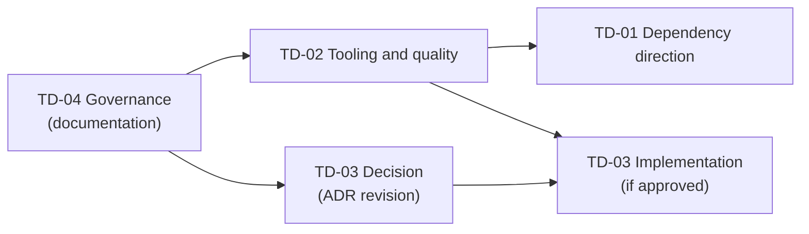

# Post-M0.2 maintenance plan

| Field    | Value                                                                   |
| -------- | ----------------------------------------------------------------------- |
| Status   | Proposed — awaiting independent review and product owner approval       |
| Date     | 2026-11-13                                                              |
| Baseline | `dev` at `c6ee4d9` (M0.2 closure)                                       |
| Register | [Technical debt register](../technical-debt.md)                         |
| Scope    | Four work packages: TD-01 to TD-04. No feature work, no M0.3 definition |

M0.1 and M0.2 are complete and stay closed. This phase repays the debt that makes the
repository's checks unreliable or its layering inaccurate, and decides how the UI will be tested,
before M0.3 is specified. Nothing in this plan is implemented until it is approved.

## 1. Boundaries

In scope: the four work packages below, and the documentation each one makes inaccurate.

Out of scope, in every work package:

- changes to engine behaviour, public contracts, error shapes or check order (`src/domain/`,
  `src/calculations/`);
- changes to user-visible behaviour, URLs or copy;
- new features, M0.3 work, and the register entries not assigned here (DEBT-11 to DEBT-22);
- dependencies outside ADR 0001, unless an approved ADR revision adds them first;
- changes to ADR 0001 without the product owner's approval.

Two work packages touch files of the closed M0.1 milestone without changing behaviour: TD-01
(a type moves) and TD-02 (formatting, test assertions). Both need explicit authorization
([decisions](#4-decisions-requiring-approval), D1).

## 2. Sequence and dependencies

Proposed order:

1. **TD-04 — governance.** Documentation only. It sets the closure checks and register rules that
   the other packages use, so it comes first.
2. **TD-02 — tooling and quality.** Makes `format:check`, `lint` and `test` deterministic and
   green. It must precede TD-01: `src/domain/chargingFactories.ts` and
   `src/calculations/result.ts` both have formatting drift, and refactoring them first would mix
   formatting into a semantic diff.
3. **TD-01 — dependency direction.** A small, type-only refactor, reviewed on a clean baseline.
4. **TD-03 — UI and end-to-end testing.** The decision (an ADR 0001 revision) can be prepared in
   parallel with TD-02, since it changes no code. Its implementation, if approved, follows TD-02,
   because it relies on deterministic checks and on the CI decision.

TD-01 and TD-03 are independent of each other; their order can be swapped if the TD-03 decision
is approved first.

## 3. Work packages

### TD-01 — Dependency direction

**Register:** DEBT-01.

#### Analysis

`src/domain/chargingFactories.ts:1` has `import type { CalculationResult } from
"@/calculations/result"`. `src/calculations/result.ts` contains only that type. The import is
type-only, so it is erased at compile time: there is no runtime dependency and no cycle. The
problem is direction: the domain is the lowest layer (calculations already import domain types),
and ADR 0001 §3 and the [charging overview](../charging/README.md) draw it that way.

Importers of `@/calculations/result` at baseline: 18 source files (domain 1, calculations 8,
scenarios 3, data 1, application 4, routes 1: `src/app/veicoli/[vehicleId]/RicaricaPreview.tsx`)
and 3 test files, including the compile-time test `tests/calculations/result.types.ts`.

#### Options

| Option | Change                                                                                                                                                                                       | Assessment                                                                                                                                                         |
| ------ | -------------------------------------------------------------------------------------------------------------------------------------------------------------------------------------------- | ------------------------------------------------------------------------------------------------------------------------------------------------------------------ |
| A      | Move the definition to `src/domain/result.ts`; `src/calculations/result.ts` becomes `export type { CalculationResult } from "@/domain/result";`; the factories import from `@/domain/result` | **Recommended.** Restores the direction with three source files. The re-export is the same type, so every existing import and assignment keeps compiling unchanged |
| B      | Move it to a new neutral module (for example `src/shared/result.ts`)                                                                                                                         | A new layer for one type. AGENTS.md and ADR 0001 §3 allow a new layer only for a concrete need; not justified                                                      |
| C      | Give the domain its own structurally identical `ValidationResult<T, E>`                                                                                                                      | Two names for one shape; `src/data/catalogue.ts` already mixes factory and calculation results. Rejected                                                           |
| D      | Accept the dependency and document it                                                                                                                                                        | Possible fallback if D1 is refused. Leaves the documentation and the code inconsistent                                                                             |

The type keeps the name `CalculationResult`. Renaming it (for example to `Result`) would change
the public API and is out of scope, even if the name reads oddly in the domain.

**Public API compatibility:** preserved. `@/calculations/result` still exports `CalculationResult`,
including through `import type * as …` as in `tests/calculations/result.types.ts`. The only
observable changes are where the type is declared and the sentence in
[public API](../charging/public-api.md) that names its file. No case was found in which
compatibility cannot be kept.

**Optional extension (A+), decision D2:** switch the type imports in `src/scenarios/` (3 files)
and `src/data/catalogue.ts` to `@/domain/result`, matching the ADR diagram (codec → domain, data
→ domain). Type-only and mechanical, but it touches M0.2 files. The application layer and routes
may keep `@/calculations/result`, since they call the engine.

**Optional guard, decision D3:** an ESLint `no-restricted-imports` entry (core rule, no new
dependency) for `src/domain/**` forbidding `@/calculations/*`, so the direction cannot regress.

#### Scope and files

- `src/domain/result.ts` (new), `src/calculations/result.ts`, `src/domain/chargingFactories.ts`.
- If A+: `src/scenarios/{searchScenario,originContext,dcSimulationScenario}.ts`,
  `src/data/catalogue.ts`. If the guard: `eslint.config.mjs`.
- Documentation: `docs/charging/public-api.md` (where the type is defined),
  `docs/charging/README.md` (source tree, layering diagram, the paragraph on this dependency),
  and a resolution note appended to item 8 of `docs/charging/limitations.md` without rewriting it.
- Register: DEBT-01 to `resolved`, with the commit.

#### Risks

- Editor tooling or documentation links that point to `calculations/result.ts` as the definition.
- Accidentally turning the re-export into a value export (`export { … }`) or a duplicate
  declaration, which would create two types. Mitigated by the compile-time test below.

#### Tests

- Existing suite unchanged: 473 tests, 26 files; `npm run typecheck` including all `*.types.ts`.
- A compile-time assertion that the type from `@/domain/result` and from `@/calculations/result`
  are mutually assignable (in an existing or new `*.types.ts` file).
- `grep` for `@/calculations` under `src/domain/` returns nothing.
- `npm run lint`, `npm run build`.

#### Acceptance criteria

- No file under `src/domain/` imports from `src/calculations/`.
- Every pre-existing import of `@/calculations/result` compiles unchanged.
- Test count and results unchanged; typecheck, lint and build succeed.
- The documentation named above describes the new location; the register entry is resolved.
- The diff contains no formatting changes outside the edited lines (TD-02 done first).

#### Stop conditions

- D1 is refused: apply option D (document the accepted dependency) and stop.
- The re-export changes type identity or breaks any compile-time test.
- Any change beyond the three files (plus A+ and the guard if approved) turns out to be needed.

### TD-02 — Tooling and quality

**Register:** DEBT-02 to DEBT-08.

#### Analysis at baseline

| Check                  | Result                                                                                                                                                                              |
| ---------------------- | ----------------------------------------------------------------------------------------------------------------------------------------------------------------------------------- |
| `npm test`             | 473/473 from `C:\…`; **26/26 files fail, 0 tests** from `c:\…` (DEBT-02). Two configuration warnings on every run (DEBT-07)                                                         |
| `npm run format:check` | 59 files on this Windows working tree: 30 differ only by CRLF (DEBT-03), 29 have content drift (DEBT-04); 29 on a clean LF checkout                                                 |
| `npm run lint`         | 0 errors, 114 warnings: 103 `no-unused-vars` in `*.types.ts` (DEBT-05), 11 `no-unused-expressions` from conditional assertions (DEBT-06); all in M0.1 tests                         |
| `npm run typecheck`    | Succeeds                                                                                                                                                                            |
| `npm ls`               | `typescript@6.0.3` invalid for `tsconfck` (`^5.0.0`), via `vite-tsconfig-paths` (DEBT-07)                                                                                           |
| Configuration          | `.prettierrc.json` is `{}`; no `.gitattributes`; `core.autocrlf=true` locally; ESLint flat config: Next core-web-vitals, Next TypeScript, `eslint-config-prettier`; no CI (DEBT-08) |

#### Strategy

The principle: **one cause per commit, and mechanical commits separated from semantic ones**. A
mechanical commit is one that a reviewer can reproduce exactly by running the stated command on
its parent; a semantic commit is reviewed line by line.

| Step | Commit                                                                                                                                                                                                                                                                                                                                                                                                                                                                         | Kind               | Necessary?                        |
| ---- | ------------------------------------------------------------------------------------------------------------------------------------------------------------------------------------------------------------------------------------------------------------------------------------------------------------------------------------------------------------------------------------------------------------------------------------------------------------------------------ | ------------------ | --------------------------------- |
| 2a   | **Line endings.** Add `.gitattributes` with `* text=auto eol=lf` and binary rules for fonts and images. Run `git add --renormalize .`: since the index is already LF, the expected commit content is the `.gitattributes` file alone, which verifies that no file changes. Developers then refresh their working tree once (procedure documented in the commit and README). Not chosen: Prettier `endOfLine: "auto"`, which would hide the inconsistency rather than remove it | Mechanical         | **Necessary** (DEBT-03)           |
| 2b   | **Drive-letter failure.** Reproduce with a minimal config; check whether replacing `vite-tsconfig-paths` with `resolve.tsconfigPaths` (2g) or an explicit `root` removes it. If a configuration fix within the stack exists, apply it; otherwise document the workaround (start from the canonical upper-case path) in the README and testing page, and record the limitation                                                                                                  | Semantic (config)  | **Necessary** (DEBT-02)           |
| 2c   | **Prettier, code.** `prettier --write` on the 22 code files of DEBT-04 only                                                                                                                                                                                                                                                                                                                                                                                                    | Mechanical         | **Necessary** (DEBT-04)           |
| 2d   | **Prettier, documents.** `prettier --write` on the 7 documents of DEBT-04, separately, because tables and wrapping in product documents change visibly                                                                                                                                                                                                                                                                                                                         | Mechanical         | **Necessary** for a green check   |
| 2e   | **Lint, compile-time tests.** A scoped override in `eslint.config.mjs` that turns off `@typescript-eslint/no-unused-vars` for `tests/**/*.types.ts` only, with a comment stating why. Not chosen: renaming 103 variables with a `_` prefix (churn) or disabling the rule globally                                                                                                                                                                                              | Semantic (config)  | **Necessary** (DEBT-05)           |
| 2f   | **Conditional assertions.** Rewrite the 12 cases of DEBT-06 so the assertion always runs, for example `expect(result).toEqual({ ok: true, value: expect.closeTo(36 / 11, 2) })` or `expect(result).toMatchObject({ ok: false, error: { type: "invalidMaxPower" } })`. No rule is disabled                                                                                                                                                                                      | Semantic (tests)   | **Necessary** (DEBT-06)           |
| 2g   | **Vitest configuration.** Rename to `vitest.config.mts`; replace `vite-tsconfig-paths` with `resolve: { tsconfigPaths: true }` and remove the package (decision D5). Update the README bootstrap choices and the testing page                                                                                                                                                                                                                                                  | Semantic (config)  | Optional (P3), unless it fixes 2b |
| 2h   | **Aggregate check.** A `check` script running `format:check`, `lint`, `typecheck` and `test`; once warnings are zero, `lint` with `--max-warnings 0` (decision D6)                                                                                                                                                                                                                                                                                                             | Semantic (scripts) | Recommended                       |
| 2i   | **Blame hygiene.** `.git-blame-ignore-revs` listing the commits of 2a, 2c and 2d                                                                                                                                                                                                                                                                                                                                                                                               | Mechanical         | Optional                          |

CI is not added by TD-02; it is decided with TD-03 (decision D8), since both suites would run in it.

#### Scope and files

`.gitattributes` (new), `eslint.config.mjs`, `vitest.config.ts` (renamed if 2g), `package.json`
(scripts; `devDependencies` only if D5), `package-lock.json` (only if D5), the 29 files of
DEBT-04, the 3 test files of DEBT-06, `README.md`, `docs/charging/testing.md`, the register,
and optionally `.git-blame-ignore-revs`. Item 11 and 12 of `docs/charging/limitations.md` and the
M0.2 non-blocking debt list receive a resolution note, not a rewrite.

#### Risks

- 2a: the working tree of each Windows clone must be refreshed once; a dirty tree at that moment
  can show spurious changes.
- 2c and 2d touch closed milestone files (D1). Prettier on Markdown may reflow tables in product
  documents.
- 2f: a rewritten assertion can be stricter than the original and fail; that would reveal a real
  defect, which must then be reported, not fixed silently.
- 2g: removing a devDependency changes the lockfile.

#### Tests

- After every commit: `npm test` (473 tests, unchanged count), `npm run typecheck`.
- 2a, 2c, 2d: reproduce the commit by running the stated command on its parent; the result must
  equal the commit (`git diff` empty).
- 2b: `npm test` from both `c:\…` and `C:\…`.
- 2f: for each rewritten assertion, temporarily break its precondition and confirm the test fails;
  revert.
- At the end: `npm run format:check`, `npm run lint` (0 warnings), `npm run build`, on Windows and
  on a clean LF checkout.

#### Acceptance criteria

- `npm run format:check` passes on Windows and on an LF checkout.
- `npm run lint` reports 0 errors and 0 warnings, with no rule disabled outside
  `tests/**/*.types.ts`.
- `npm test` passes with 473 tests (or more, never fewer) regardless of the drive-letter case, or
  the workaround is documented and the limitation recorded in the register.
- No change to the behaviour of any source file; mechanical commits are reproducible.
- Register entries DEBT-02 to DEBT-07 resolved or explicitly accepted; DEBT-08 updated.

#### Stop conditions

- D1 refused: limit TD-02 to 2a, 2b, 2e, 2g and 2h; record DEBT-04 and DEBT-06 as open.
- A step needs a dependency outside ADR 0001 or a change in engine behaviour.
- 2f reveals a failing behaviour: stop the step, report the defect for a separate decision.
- 2a changes the content of any file in the index.

### TD-03 — UI and end-to-end testing strategy

**Register:** DEBT-09, DEBT-10, and DEBT-08 for CI.

#### Current state

- Vitest runs 473 tests in the Node environment, all on pure modules: domain, calculations,
  catalogue, scenario codecs, application logic (including the simulator's interaction rules in
  `src/application/dcSimulatorInteraction.ts`) and presentation helpers.
- React code has no automated test: 9 components in `src/components/` and the route views in
  `src/app/` (`DiscoveryView`, `VehicleAnalysisView`, `RicaricaPreview`, `DcSimulatorView`). Client components: `DiscoveryView`, `DcSimulatorView`, `AppHeader`, `DcPowerChart`.
  The Discovery and Vehicle Analysis pages are **async Server Components**.
- The riskiest behaviour of M0.2 — the simulator's URL, history, drag and Back/Forward handling —
  depends on real browser APIs (History, the Navigation API, pointer capture) and on Next.js. It
  is covered only by `scripts/verify-dc-simulator-url.mjs`: 154 checks through the Chrome
  DevTools protocol, no dependency, run by hand against `next build` + `next start`, Chromium or
  Edge only. Its selectors are mostly roles and ARIA attributes (`[role="radio"][aria-checked]`,
  `nav[aria-label="Contesto"]`, `input[type="range"]`), plus one CSS Module class match
  (`[class*="sliderTrack"]`).
- No CI.

#### Alternatives

| Option                                    | Level           | Dependency cost                                                                      | Next.js App Router                                                                                                                      | Browsers                                                  | Windows                               | Assessment                                                                                                                               |
| ----------------------------------------- | --------------- | ------------------------------------------------------------------------------------ | --------------------------------------------------------------------------------------------------------------------------------------- | --------------------------------------------------------- | ------------------------------------- | ---------------------------------------------------------------------------------------------------------------------------------------- |
| Keep the bespoke script                   | E2E             | None                                                                                 | Real build, full fidelity                                                                                                               | Chromium only; extending it means a WebDriver BiDi client | Yes                                   | Zero cost now, but a 955-line private harness (waiting, protocol, reporting) to maintain; no CI integration, no traces                   |
| Vitest + React Testing Library + jsdom    | Component       | `@testing-library/react`, `@testing-library/dom`, `jsdom` (+ optional `user-event`)  | Cannot render async Server Components; `next/navigation` must be mocked                                                                 | None (simulated DOM)                                      | Yes                                   | Fast, but jsdom lacks layout, pointer capture and the Navigation API, exactly what the simulator depends on. Low value for this codebase |
| Vitest Browser Mode (Playwright provider) | Component       | `@vitest/browser-playwright` and Playwright                                          | Same limits on Server Components and router as above                                                                                    | Chromium, Firefox, WebKit                                 | Yes                                   | Real browser, same runner. Useful later for isolated components (chart, slider); not for routes                                          |
| **Playwright Test**                       | E2E             | `@playwright/test`; browser binaries, or the installed Chrome/Edge through `channel` | Runs against `next build` + `next start` through its `webServer` option; no mocking; recommended by Next.js for async Server Components | Chromium, Firefox, WebKit as separate projects            | Yes; can use installed Chrome or Edge | Role- and label-based locators, traces, retries, parallelism, documented CI setup. One devDependency                                     |
| Cypress                                   | E2E + component | `cypress` and its Electron binary                                                    | Works against a running server                                                                                                          | Chromium, Firefox; WebKit experimental                    | Yes                                   | Heavier, separate command model, weaker WebKit; no advantage over Playwright here                                                        |

#### Proposal

Proportionate to a project whose logic is already extracted into pure, tested functions:

1. **End-to-end tests with Playwright Test**, against a production build, as the only new test
   tool. Start with the Chromium project, running locally on the installed Chrome or Edge to
   avoid browser downloads on Windows. Firefox and WebKit are added later as configuration-only
   projects.
2. **Port the simulator checks** from `scripts/verify-dc-simulator-url.mjs`, then the navigation
   scenarios of the M0.2 acceptance criteria. The script stays until the port reaches parity on
   its 154 checks, then is retired (decision D10).
3. **No component-test tool now.** Logic stays in pure functions tested by Vitest. If a component
   later holds logic that can be neither extracted nor covered end to end, the preferred option
   is Vitest Browser Mode with the Playwright provider, which reuses the same browsers; jsdom is
   not recommended for this codebase.
4. **Selector policy:** `getByRole` and `getByLabel` with the accessible name first, so that
   tests also check accessible names; text second; `data-testid` only for elements without
   accessible semantics (for example the slider track used for pointer coordinates), which needs
   decision D9 because it adds attributes to components. No CSS class selectors.
5. **CI (decision D8):** a GitHub Actions workflow running the TD-02 `check` command on every push
   and pull request, and the end-to-end suite on pull requests to `master` and on every Next.js
   update. Optionally a Windows runner, which would have caught DEBT-02 and DEBT-03.
6. **Out of scope:** screen-reader verification (DEBT-11) remains manual.

#### Scope and files

Decision phase: an ADR 0001 revision (§2 stack table, §7 testing, open question 8), written by or
for the product owner — not by this plan. Implementation phase, only after approval:
`package.json` and `package-lock.json` (`@playwright/test`), `playwright.config.ts`, an `e2e/`
directory (location to confirm), `.gitignore` (reports and traces), the workflow under
`.github/workflows/` if D8, `README.md`, the testing documentation, and the register.

#### Risks

- A new dependency with large browser binaries on CI (cacheable).
- Flaky tests around drag and history timing; Playwright's auto-waiting reduces but does not
  remove this.
- Locators by Italian accessible names break when copy changes; that is intended, since copy is
  part of the accepted behaviour, but it couples tests to wording.
- Porting may reveal differences from the hand-written script's results.

#### Tests

- The ported suite passes on Chromium against `next build` + `next start`, on Windows and in CI.
- During porting, the script and the suite both pass on the same build.
- The existing Vitest suite is unaffected.

#### Acceptance criteria

- ADR 0001 open question 8 is resolved by an approved revision before any package is installed.
- All 154 checks of the script, or their documented equivalents, pass in Playwright Test.
- No CSS class selectors; any `data-testid` is approved and listed.
- The suite runs with one npm script and, if approved, in CI.
- The README and testing documentation describe how to run it; DEBT-09 and DEBT-10 are resolved,
  DEBT-08 updated.

#### Stop conditions

- The ADR revision is not approved: TD-03 ends with the decision record; the script stays and
  DEBT-10 keeps its manual trigger.
- A check cannot be reproduced in Playwright without changing application behaviour.
- Running locally on Windows requires anything beyond the documented commands.

### TD-04 — Debt governance

**Register:** all entries.

#### Updating the register

- Any task that finds debt adds an entry before it closes; any task that resolves one updates it
  in the same commit as the fix.
- Identifiers are stable and never reused. Entries are not deleted: a resolved entry keeps its
  text, its status becomes `resolved`, and it records the commit.
- The original source is not rewritten. When an entry changes status, a short note is appended to
  the source item (for example "Resolved in `<sha>`, see DEBT-01").
- Reports that share a cause are merged into one entry listing every source.
- Every milestone closure and every review that raises caveats ends with a register update.
- The register states what is in the code at its baseline; it is re-verified, not copied, when
  the baseline moves.

#### Priority criteria

| Priority | Assigned when                                                                                                                 |
| -------- | ----------------------------------------------------------------------------------------------------------------------------- |
| P1       | A check or test gives a false result or cannot fail; or there is a risk to correctness of results, data integrity or security |
| P2       | The next milestone touches the area, or the debt blocks planned work, or its cost of resolution grows with each change        |
| P3       | Harmless until a stated trigger; the trigger is recorded                                                                      |

Impact, likelihood, growth of cost over time and coupling with upcoming work justify the level in
the entry's text.

#### Assigning an entry to a milestone or work package

- An entry becomes `scheduled` only when the product owner approves a work package or milestone
  that lists its identifier and acceptance criteria.
- P1 entries are scheduled at the latest with the next approved work.
- P2 entries are scheduled with the milestone that touches their area, or before it.
- P3 entries are scheduled only when their trigger occurs.
- A feature milestone does not absorb debt implicitly: its specification lists the identifiers it
  resolves.
- C5 and C6 items are never scheduled as maintenance; a C4 item is scheduled only after its
  decision is taken.

#### Accepting a limitation

An entry becomes `accepted limitation` only if all of these hold:

- the behaviour and its consequences are documented where users of the code will read them;
- it causes no incorrect result, data loss or security risk within the documented range;
- the cost of a fix is disproportionate, or it depends on an undecided product question;
- the product owner approves it explicitly, with a date;
- a condition for revisiting it is recorded.

#### Closing a work package

Before a work package is closed:

1. `npm run format:check`, `npm run lint`, `npm run typecheck`, `npm test` and `npm run build`
   pass; the results, including warnings and the test count, are reported. Test count never
   decreases without a stated reason.
2. When routes, URL handling or Next.js change: the browser verification (script or its
   successor) passes.
3. The diff contains only the files in the work package's scope; mechanical and semantic changes
   are in separate commits; mechanical commits are reproducible.
4. Documentation made inaccurate by the change is updated; status texts distinguish implemented
   from approved.
5. The register is updated with commits and statuses.
6. An independent review accepts the work and the product owner approves the closure.

#### Scope and files

This plan and the register only. No code.

#### Acceptance criteria and stop conditions

Accepted when the product owner approves the rules above. If any rule conflicts with AGENTS.md or
ADR 0001, those documents prevail and the conflict is reported.

## 4. Decisions requiring approval

| ID  | Decision                                                                                                                                                                                          | Needed by   | Recommendation                        |
| --- | ------------------------------------------------------------------------------------------------------------------------------------------------------------------------------------------------- | ----------- | ------------------------------------- |
| D1  | Authorise behaviour-neutral changes to closed M0.1 files: type move (TD-01), formatting (TD-02 2c), test assertions (TD-02 2f)                                                                    | TD-01/TD-02 | Approve                               |
| D2  | Extend TD-01 to the type imports in `src/scenarios/` and `src/data/` (A+)                                                                                                                         | TD-01       | Approve                               |
| D3  | Add a `no-restricted-imports` guard for `src/domain/`                                                                                                                                             | TD-01       | Approve                               |
| D4  | Format the 7 product and UX documents with Prettier, or exclude them from Prettier in `.prettierignore`                                                                                           | TD-02 2d    | Format                                |
| D5  | Remove `vite-tsconfig-paths` in favour of Vite's native `resolve.tsconfigPaths`                                                                                                                   | TD-02 2g    | Approve if 2b confirms no regression  |
| D6  | Make lint fail on warnings (`--max-warnings 0`) and add a `check` script                                                                                                                          | TD-02 2h    | Approve                               |
| D7  | Adopt the governance rules of TD-04, including the meaning of `accepted limitation`                                                                                                               | TD-04       | Approve                               |
| D8  | Introduce CI (GitHub Actions): which checks gate a merge, and whether to include a Windows runner                                                                                                 | TD-02/TD-03 | Approve, with a Windows runner        |
| D9  | Allow `data-testid` attributes where no accessible handle exists                                                                                                                                  | TD-03       | Approve, restricted                   |
| D10 | Revise ADR 0001: resolve open question 8 with Playwright Test for end-to-end tests, no component-test tool for now; add `@playwright/test`; initial browser Chromium; retire the script at parity | TD-03       | Approve                               |
| D11 | Accept DEBT-12 (marginal URL limits) as an accepted limitation                                                                                                                                    | TD-04       | Approve, revisit on a reported defect |

## 5. Closure of the phase

The phase is complete when TD-04 is approved; TD-02 and TD-01 are closed under the TD-04 rules;
TD-03 has an approved ADR revision and, if approved, an implementation at parity with the script;
and the register reflects the result. M0.3 is specified afterwards and lists the register entries
it takes on.
