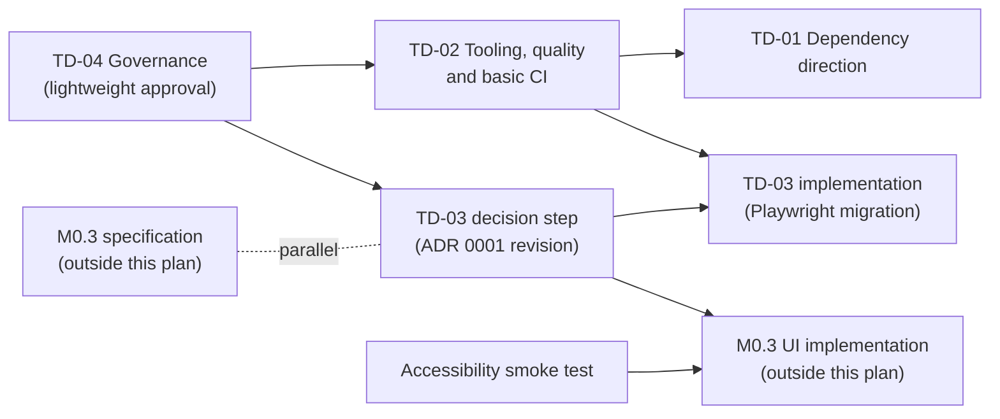

# Post-M0.2 maintenance plan

| Field     | Value                                                                                                    |
| --------- | -------------------------------------------------------------------------------------------------------- |
| Status    | **Approved with amendments** on 2026-11-14 after independent review. **Not implemented**                 |
| Date      | Proposed 2026-11-13; revised 2026-11-14                                                                  |
| Baseline  | `dev` at `c6ee4d9` (M0.2 closure)                                                                        |
| Register  | [Technical debt register](../technical-debt.md)                                                          |
| Scope     | Four work packages, TD-01 to TD-04, and an accessibility smoke test. No feature work, no M0.3 definition |
| Decisions | [§5](#5-decisions): D1–D10 approved, some with conditions; D11 rejected                                  |

M0.1 and M0.2 are complete and stay closed. This phase repays the debt that makes the
repository's checks unreliable or its layering inaccurate, and decides how the UI will be tested.

Approval and implementation are distinct. Everything in §3 and §4 is approved direction; none of
it is implemented until the work package that carries it is done and recorded in the register.

## 1. Boundaries

In scope: the four work packages and the accessibility smoke test below, and the documentation
each one makes inaccurate.

Out of scope, in every work package:

- changes to engine behaviour, public contracts, error shapes or check order (`src/domain/`,
  `src/calculations/`);
- changes to user-visible behaviour, URLs or copy;
- new features, M0.3 work, and the register entries not assigned here (DEBT-12 to DEBT-22);
- dependencies outside ADR 0001, unless an approved ADR revision adds them first;
- changes to ADR 0001 outside TD-03's decision step.

TD-01 (a type moves) and TD-02 (formatting, test assertions) touch files of the closed M0.1
milestone without changing behaviour. This is authorised by D1. Formatting, assertion rewrites
and the type relocation are always in separate commits.

## 2. Sequence and dependencies

Order:

1. **TD-04 — governance.** A lightweight approval of the rules in TD-04; documentation only.
2. **TD-02 — tooling, quality and basic CI.** Makes `format:check`, `lint`, `typecheck`, `test`
   and `build` deterministic and green, adds the aggregate `check` command and a basic GitHub
   Actions CI.
3. **TD-01 — dependency direction**, as soon as TD-02 has made `src/domain/chargingFactories.ts`
   and `src/calculations/result.ts` formatting-clean, so the refactor diff contains no formatting.
   It does not need the rest of TD-02.
4. **TD-03 — UI and end-to-end testing.** Its decision step (the ADR 0001 revision) can start at
   any time and is reviewed separately. Its implementation follows TD-02, because it relies on
   deterministic checks and adds a job to the CI that TD-02 creates.

In parallel, outside the work packages:

- **M0.3 specification** may proceed in parallel with TD-03. This plan does not define M0.3.
- **M0.3 UI implementation** does not begin before the TD-03 testing-strategy ADR decision is
  approved. Whether the complete Playwright migration must also be finished first depends on the
  actual M0.3 scope and is decided when M0.3 is specified.
- **The [accessibility smoke test](#accessibility-smoke-test)** can run at any time and must be
  done before additional interactive UI is implemented.

## 3. Work packages

### TD-01 — Dependency direction

**Register:** DEBT-01. **Decisions:** D1, D2, D3 approved.

#### Analysis

`src/domain/chargingFactories.ts:1` has `import type { CalculationResult } from
"@/calculations/result"`. `src/calculations/result.ts` contains only that type. The import is
type-only, so it is erased at compile time: there is no runtime dependency and no cycle. The
problem is direction: the domain is the lowest layer (calculations already import domain types),
and ADR 0001 §3 and the [charging overview](../charging/README.md) draw it that way.

Importers of `@/calculations/result` at baseline: 18 source files (domain 1, calculations 8,
scenarios 3, data 1, application 4, routes 1: `src/app/veicoli/[vehicleId]/RicaricaPreview.tsx`)
and 3 test files, including the compile-time test `tests/calculations/result.types.ts`.

#### Options

| Option | Change                                                                                                                                                                                       | Assessment                                                                                                                                                      |
| ------ | -------------------------------------------------------------------------------------------------------------------------------------------------------------------------------------------- | --------------------------------------------------------------------------------------------------------------------------------------------------------------- |
| A      | Move the definition to `src/domain/result.ts`; `src/calculations/result.ts` becomes `export type { CalculationResult } from "@/domain/result";`; the factories import from `@/domain/result` | **Approved.** Restores the direction with three source files. The re-export is the same type, so every existing import and assignment keeps compiling unchanged |
| B      | Move it to a new neutral module (for example `src/shared/result.ts`)                                                                                                                         | A new layer for one type. AGENTS.md and ADR 0001 §3 allow a new layer only for a concrete need; not justified                                                   |
| C      | Give the domain its own structurally identical `ValidationResult<T, E>`                                                                                                                      | Two names for one shape; `src/data/catalogue.ts` already mixes factory and calculation results. Rejected                                                        |
| D      | Accept the dependency and document it                                                                                                                                                        | Fallback only if option A proves incompatible (stop conditions)                                                                                                 |

The type keeps the name `CalculationResult`. Renaming it (for example to `Result`) would change
the public API and is out of scope, even if the name reads oddly in the domain.

**Public API compatibility:** preserved. `@/calculations/result` still exports `CalculationResult`,
including through `import type * as …` as in `tests/calculations/result.types.ts`. The only
observable changes are where the type is declared and the sentence in
[public API](../charging/public-api.md) that names its file. No case was found in which
compatibility cannot be kept.

**Extension A+ (D2, approved):** switch the type imports in `src/scenarios/` (3 files) and
`src/data/catalogue.ts` to `@/domain/result`, matching the ADR diagram (codec → domain, data →
domain). Type-only and mechanical. The application layer and routes keep `@/calculations/result`,
since they call the engine.

**Guard (D3, approved):** an ESLint `no-restricted-imports` entry (core rule, no new dependency)
for `src/domain/**` forbidding `@/calculations/*`, so the direction cannot regress.

#### Scope and files

- `src/domain/result.ts` (new), `src/calculations/result.ts`, `src/domain/chargingFactories.ts`.
- A+: `src/scenarios/{searchScenario,originContext,dcSimulationScenario}.ts`,
  `src/data/catalogue.ts`. Guard: `eslint.config.mjs`.
- Documentation: `docs/charging/public-api.md` (where the type is defined),
  `docs/charging/README.md` (source tree, layering diagram, the paragraph on this dependency),
  and item 8 of `docs/charging/limitations.md`, which would otherwise describe a dependency that no
  longer exists (a short resolution note, not a rewrite).
- Register: DEBT-01 to `resolved`, with the commit.

#### Risks

- Editor tooling or documentation links that point to `calculations/result.ts` as the definition.
- Accidentally turning the re-export into a value export (`export { … }`) or a duplicate
  declaration, which would create two types. Mitigated by the compile-time test below.

#### Tests

- Existing suite unchanged: 473 tests, 26 files; `npm run typecheck` including all `*.types.ts`.
- A compile-time assertion that the type from `@/domain/result` and from `@/calculations/result`
  are mutually assignable (in an existing or new `*.types.ts` file).
- `npm run check` (from TD-02), and the guard rejects a deliberate test import of
  `@/calculations/result` in `src/domain/` (tried locally, not committed).

#### Acceptance criteria

- No file under `src/domain/` imports from `src/calculations/`, and lint enforces it.
- Every pre-existing import of `@/calculations/result` outside the A+ files compiles unchanged.
- Test count and results unchanged; `npm run check` passes.
- The documentation named above describes the new location; the register entry is resolved.
- The diff contains no formatting changes outside the edited lines.

#### Stop conditions

- The re-export changes type identity or breaks any compile-time test: stop and report; option D
  is the fallback, subject to approval.
- Any change beyond the files listed above turns out to be needed.

### TD-02 — Tooling and quality

**Register:** DEBT-02 to DEBT-08. **Decisions:** D1, D4, D6, D8 approved; D5 conditionally
approved.

#### Analysis at baseline

| Check                  | Result                                                                                                                                                                              |
| ---------------------- | ----------------------------------------------------------------------------------------------------------------------------------------------------------------------------------- |
| `npm test`             | 473/473 from `C:\…`; **26/26 files fail, 0 tests** from `c:\…` (DEBT-02). Two configuration warnings on every run (DEBT-07)                                                         |
| `npm run format:check` | 59 files on this Windows working tree: 30 differ only by CRLF (DEBT-03), 29 have content drift (DEBT-04); 29 on a clean LF checkout                                                 |
| `npm run lint`         | 0 errors, 114 warnings: 103 `no-unused-vars` in `*.types.ts` (DEBT-05), 11 `no-unused-expressions` from conditional assertions (DEBT-06); all in M0.1 tests                         |
| `npm run typecheck`    | Succeeds                                                                                                                                                                            |
| `npm ls --all`         | Exits 1 (`ELSPROBLEMS`): `typescript@6.0.3` invalid for the optional peer `^5.0.0` of `tsconfck`, via `vite-tsconfig-paths` (DEBT-07). Plain `npm ls` exits 0                       |
| Configuration          | `.prettierrc.json` is `{}`; no `.gitattributes`; `core.autocrlf=true` locally; ESLint flat config: Next core-web-vitals, Next TypeScript, `eslint-config-prettier`; no CI (DEBT-08) |

#### Strategy

The principle: **one cause per commit, and mechanical commits separated from semantic ones**. A
mechanical commit is one that a reviewer can reproduce exactly by running the stated command on
its parent; a semantic commit is reviewed line by line.

| Step | Commit                                                                                                                                                                                                                                                                                                                                                                                                                                                                         | Kind               | Status in plan         |
| ---- | ------------------------------------------------------------------------------------------------------------------------------------------------------------------------------------------------------------------------------------------------------------------------------------------------------------------------------------------------------------------------------------------------------------------------------------------------------------------------------ | ------------------ | ---------------------- |
| 2a   | **Line endings.** Add `.gitattributes` with `* text=auto eol=lf` and binary rules for fonts and images. Run `git add --renormalize .`: since the index is already LF, the expected commit content is the `.gitattributes` file alone, which verifies that no file changes. Developers then refresh their working tree once (procedure documented in the commit and README). Not chosen: Prettier `endOfLine: "auto"`, which would hide the inconsistency rather than remove it | Mechanical         | Required (DEBT-03)     |
| 2b   | **Drive-letter failure.** Reproduce with a minimal configuration and find the cause. Fix it within the stack so that `npm test` passes from both `c:\…` and `C:\…`. Replacing `vite-tsconfig-paths` (2g) is one candidate but is **not assumed** to fix it. A documented workaround is not an acceptable outcome                                                                                                                                                               | Semantic (config)  | Required (DEBT-02)     |
| 2c   | **Prettier, code.** Re-inventory the drift immediately before this step (`prettier --list-different .` on an LF checkout), then `prettier --write` on the code files of that inventory only                                                                                                                                                                                                                                                                                    | Mechanical         | Required (DEBT-04, D1) |
| 2d   | **Prettier, documents.** `prettier --write` on the documents of the same inventory, in a separate commit, because tables and wrapping in product documents change visibly                                                                                                                                                                                                                                                                                                      | Mechanical         | Required (DEBT-04, D4) |
| 2e   | **Lint, compile-time tests.** A scoped override in `eslint.config.mjs` that turns off `@typescript-eslint/no-unused-vars` for `tests/**/*.types.ts` only, with a comment stating why. Not chosen: renaming 103 variables with a `_` prefix (churn) or disabling the rule globally                                                                                                                                                                                              | Semantic (config)  | Required (DEBT-05)     |
| 2f   | **Conditional assertions.** Rewrite the 12 cases of DEBT-06 so the assertion always runs, for example `expect(result).toEqual({ ok: true, value: expect.closeTo(36 / 11, 2) })` or `expect(result).toMatchObject({ ok: false, error: { type: "invalidMaxPower" } })`. No rule is disabled                                                                                                                                                                                      | Semantic (tests)   | Required (DEBT-06, D1) |
| 2g   | **Vitest configuration.** Rename to `vitest.config.mts`. Replace `vite-tsconfig-paths` with `resolve: { tsconfigPaths: true }` and remove the package **only if** the `@/` alias still resolves in tests, `npm run typecheck` and `npm test` stay correct, and the drive-letter issue is resolved (by this change or by 2b). Otherwise keep the plugin and record why. Update the README bootstrap choices and the testing page                                                | Semantic (config)  | Conditional (D5)       |
| 2h   | **Aggregate check and zero-warning gate.** `lint` runs with `--max-warnings 0`; a `check` script runs, in order, `format:check`, `lint`, `typecheck`, `test` and `build`                                                                                                                                                                                                                                                                                                       | Semantic (scripts) | Required (D6)          |
| 2i   | **Basic CI.** A GitHub Actions workflow, described [below](#basic-ci)                                                                                                                                                                                                                                                                                                                                                                                                          | Semantic (CI)      | Required (D8)          |
| 2j   | **Blame hygiene.** `.git-blame-ignore-revs` listing the commits of 2a, 2c and 2d                                                                                                                                                                                                                                                                                                                                                                                               | Mechanical         | Optional               |

#### Basic CI

- **Triggers:** every pull request; also pushes to `dev` and `master`, so that work pushed
  directly to `dev` is checked after the fact.
- **Linux job** (`ubuntu-latest`, Node.js 24 as in the README, `npm ci`): `npm run check`, the
  complete required checks: formatting, zero-warning lint, typecheck, Vitest, production build.
- **Windows job** (`windows-latest`, Node.js 24, `npm ci`): `npm run format:check` and `npm test`.
  The runner's workspace path starts with an upper-case drive letter, so `npm test` runs twice:
  once from the workspace path and once after changing to the same path with a lower-case drive
  letter. Without the second run the job would not guard against DEBT-02.
- **Required checks and merge gating:** both jobs are required status checks for pull requests
  into `master`. Required checks are a repository setting on GitHub (branch protection or a
  ruleset), configured by the repository owner; the workflow file alone does not enforce them.
  Whether `dev` is also protected, and whether direct pushes to `dev` continue, is open
  (decision O1 in §5).
- **Out of TD-02:** the Playwright job, added by TD-03.

#### Scope and files

`.gitattributes` (new), `.github/workflows/ci.yml` (new), `eslint.config.mjs`, `vitest.config.ts`
(renamed in 2g), `package.json` (scripts; `devDependencies` only under D5), `package-lock.json`
(only under D5), the files of the re-inventoried DEBT-04 list, the 3 test files of DEBT-06,
`README.md` (commands, CI, line-ending refresh), `docs/charging/testing.md` (commands and
configuration, which would otherwise be inaccurate), the register, and optionally
`.git-blame-ignore-revs`. Items 11 and 12 of `docs/charging/limitations.md` receive a short
resolution note because that page describes the current implementation. The closed M0.2
milestone's non-blocking debt list is a historical record and is not edited; the register carries
the status.

#### Risks

- 2a: the working tree of each Windows clone must be refreshed once; a dirty tree at that moment
  can show spurious changes.
- 2b: the cause may lie in Vitest or Vite rather than in the configuration; see stop conditions.
- 2c and 2d: Prettier on Markdown may reflow tables in product documents.
- 2f: a rewritten assertion can be stricter than the original and fail; that would reveal a real
  defect, which must then be reported, not fixed silently.
- 2g: removing a devDependency changes the lockfile.
- 2i: CI depends on third-party actions (`actions/checkout`, `actions/setup-node`), whose versions
  must be pinned; the lower-case path step on Windows must be verified to run Vitest from the
  lower-case path for real (for example by printing `process.cwd()`).

#### Tests

- After every commit: `npm test` (473 tests, unchanged count) and `npm run typecheck`.
- 2a, 2c, 2d: reproduce the commit by running the stated command on its parent; the result must
  equal the commit (`git diff` empty).
- 2b and 2g: `npm test` from both `c:\…` and `C:\…`, locally and in the Windows CI job.
- 2f: for each rewritten assertion, temporarily break its precondition and confirm the test fails;
  revert.
- 2i: a pull request with a deliberate formatting error and one with a failing test, each failing
  the expected job (not merged).
- At the end: `npm run check` on Windows and on Linux; `npm ls --all` exits 0 if 2g removed the
  plugin.

#### Acceptance criteria

- `npm run format:check` passes on Windows and on an LF checkout.
- `npm run lint` reports 0 errors and 0 warnings and fails on any warning; no rule is disabled
  outside `tests/**/*.types.ts`.
- `npm test` passes with 473 tests (or more, never fewer) on Windows from both upper- and
  lower-case drive-letter paths. DEBT-02 is resolved only then.
- `npm run check` runs formatting, lint, typecheck, tests and build, and passes.
- CI runs on every pull request: the Linux job runs `npm run check`, the Windows job runs
  formatting and Vitest from both path forms; both pass. The required checks are documented in
  the README.
- No change to the behaviour of any source file; mechanical commits are reproducible.
- Register entries DEBT-02 to DEBT-08 resolved, or DEBT-07 recorded with the reason the plugin was
  kept.

#### Stop conditions

- No fix for DEBT-02 can be found within the stack: stop, report the cause and the options found.
  DEBT-02 stays P1 and TD-02 is not closed.
- A step needs a dependency outside ADR 0001 or a change in engine behaviour.
- 2f reveals a failing behaviour: stop the step, report the defect for a separate decision.
- 2a changes the content of any file in the index.

### TD-03 — UI and end-to-end testing strategy

**Register:** DEBT-09, DEBT-10. **Decisions:** D10 approved in principle; D9 approved with
restrictions.

TD-03 has two steps:

1. **Decision step.** An ADR 0001 revision that resolves open question 8, reviewed and approved
   separately before any package is installed. ADR 0001 is not revised by this plan.
2. **Implementation step.** After the revision is approved and TD-02 is closed.

#### Current state

- Vitest runs 473 tests in the Node environment, all on pure modules: domain, calculations,
  catalogue, scenario codecs, application logic (including the simulator's interaction rules in
  `src/application/dcSimulatorInteraction.ts`) and presentation helpers.
- React code has no automated test: 9 components in `src/components/` and the route views in
  `src/app/` (`DiscoveryView`, `VehicleAnalysisView`, `RicaricaPreview`, `DcSimulatorView`).
  Client components: `DiscoveryView`, `DcSimulatorView`, `AppHeader`, `DcPowerChart`. The
  Discovery and Vehicle Analysis pages are **async Server Components**.
- The riskiest behaviour of M0.2 — the simulator's URL, history, drag and Back/Forward handling —
  depends on real browser APIs (History, the Navigation API, pointer capture) and on Next.js. It
  is covered only by `scripts/verify-dc-simulator-url.mjs`: 154 checks through the Chrome
  DevTools protocol, no dependency, run by hand against `next build` + `next start`, Chromium or
  Edge only.
- **Selector inventory of the script.** Results and controls are located by:
  - five CSS Module class-name matches: `[class*="socValue"]`, `[class*="_resultConditions"] dd`,
    `[class$="_time"] dd`, `[class$="_energy"] dd`, and `[class*="sliderTrack"]` for pointer
    geometry;
  - element type and `href`: `input[type="range"]`, `a[href^="/veicoli/nordis-e4?"]`,
    `[href*="simulazione-dc"]`, an exact `a[href=…]`;
  - roles and ARIA attributes: `[role="radio"]` (by index), `[aria-checked="true"]`,
    `nav[aria-label="Contesto"] a`;
  - whole-page text (`document.body.textContent`, for example the invalid-parameters notice).

  It also detects hydration through React's internal `__reactProps` keys, and manipulates the page
  to simulate external changes: `history.pushState`/`replaceState`, `history.back`/`forward`, a
  patched `navigation.addEventListener`, and `window.navigation` removed by an init script.

- No CI yet; TD-02 adds it.

#### Alternatives

| Option                                    | Level           | Dependency cost                                                                      | Next.js App Router                                                                                                                      | Browsers                                                  | Windows                               | Assessment                                                                                                                               |
| ----------------------------------------- | --------------- | ------------------------------------------------------------------------------------ | --------------------------------------------------------------------------------------------------------------------------------------- | --------------------------------------------------------- | ------------------------------------- | ---------------------------------------------------------------------------------------------------------------------------------------- |
| Keep the bespoke script                   | E2E             | None                                                                                 | Real build, full fidelity                                                                                                               | Chromium only; extending it means a WebDriver BiDi client | Yes                                   | Zero cost now, but a 955-line private harness (waiting, protocol, reporting) to maintain; no CI integration, no traces                   |
| Vitest + React Testing Library + jsdom    | Component       | `@testing-library/react`, `@testing-library/dom`, `jsdom` (+ optional `user-event`)  | Cannot render async Server Components; `next/navigation` must be mocked                                                                 | None (simulated DOM)                                      | Yes                                   | Fast, but jsdom lacks layout, pointer capture and the Navigation API, exactly what the simulator depends on. Low value for this codebase |
| Vitest Browser Mode (Playwright provider) | Component       | `@vitest/browser-playwright` and Playwright                                          | Same limits on Server Components and router as above                                                                                    | Chromium, Firefox, WebKit                                 | Yes                                   | Real browser, same runner. Possible later for isolated components (chart, slider); not for routes                                        |
| **Playwright Test**                       | E2E             | `@playwright/test`; browser binaries, or the installed Chrome/Edge through `channel` | Runs against `next build` + `next start` through its `webServer` option; no mocking; recommended by Next.js for async Server Components | Chromium, Firefox, WebKit as separate projects            | Yes; can use installed Chrome or Edge | **Approved in principle (D10).** Role- and label-based locators, traces, retries, documented CI setup. One devDependency                 |
| Cypress                                   | E2E + component | `cypress` and its Electron binary                                                    | Works against a running server                                                                                                          | Chromium, Firefox; WebKit experimental                    | Yes                                   | Heavier, separate command model, weaker WebKit; no advantage over Playwright here                                                        |

#### Approved direction

1. **Playwright Test for end-to-end tests**, against a production build, as the only new test
   tool. **No component-test framework** is introduced. Logic stays in pure functions tested by
   Vitest.
2. **Automation is separate from cross-browser coverage.** The initial automated baseline is
   Chromium only. Covering Firefox or WebKit is a future, explicit product decision; Playwright
   keeps it possible but this plan does not commit to it.
3. **Behavioural traceability matrix first.** Before any migration, a matrix maps every behaviour
   and edge case verified by `scripts/verify-dc-simulator-url.mjs`, and every M0.2 acceptance
   criterion that concerns browser behaviour, to its planned Playwright coverage (test name), or
   records why it is not covered. Parity is measured in behaviours and edge cases, not in the
   literal count of 154 checks. The matrix is reviewed before migration starts and again at
   parity.
4. **Same build for both suites.** During migration, the old script and the new suite run against
   the same production build, and their results are compared.
5. **Retirement.** The script is removed only after reviewed coverage parity against the matrix.
6. **Selector policy (D9).** Accessible locators first (`getByRole`, `getByLabel` with the
   accessible name), then visible text. `data-testid` is allowed only where accessible semantic
   locators are insufficient, primarily for geometry-dependent interactions such as the pointer
   position on the slider track. Each `data-testid` is listed in the testing documentation with
   its reason. No CSS class or React-internal selectors: the five class-name matches and the
   `__reactProps` probe are replaced, for example by accessible structure and Playwright's
   auto-waiting on observable state. Simulated external URL changes stay as explicit
   `page.evaluate` or `page.addInitScript` steps.
7. **CI.** TD-03 adds an end-to-end job to the TD-02 workflow: browser setup (Playwright's
   Chromium with its system dependencies on Linux, cached between runs), a production build
   started through `webServer`, and failure artefacts (trace, screenshot and HTML report uploaded
   when a test fails). Whether the job is a required check is decided with the ADR revision.
8. **Out of scope:** screen-reader and keyboard verification by a person
   ([accessibility smoke test](#accessibility-smoke-test)).

#### Scope and files

Decision step: the ADR 0001 revision (§2 stack table, §7 testing, open question 8), reviewed
separately. Implementation step: `package.json` and `package-lock.json` (`@playwright/test`),
`playwright.config.ts`, the end-to-end test directory (location to confirm), `.gitignore`
(reports and traces), the end-to-end job in `.github/workflows/ci.yml`, the traceability matrix
(in the testing documentation), component files only for approved `data-testid` attributes,
`README.md`, the testing documentation, and the register.

#### Risks

- A new dependency with large browser binaries on CI (cacheable).
- Flaky tests around drag and history timing; Playwright's auto-waiting reduces but does not
  remove this.
- Locators by Italian accessible names break when copy changes; that is intended, since copy is
  part of the accepted behaviour, but it couples tests to wording.
- Replacing class-name selectors may show that some results lack an accessible structure; adding
  one would be a UI change outside TD-03 and needs a decision.
- Local runs on branded Chrome or Edge and CI runs on Playwright's Chromium may differ slightly.

#### Tests

- The matrix is complete and reviewed before migration.
- The old script and the new suite both pass against the same production build.
- The suite passes on Chromium locally on Windows and in CI.
- The existing Vitest suite and `npm run check` are unaffected.

#### Acceptance criteria

- ADR 0001 open question 8 is resolved by an approved revision before any package is installed.
- Every row of the matrix is covered by a passing Playwright test or has an approved reason.
- No CSS class or React-internal selectors; every `data-testid` is justified and documented.
- The suite runs with one npm script and in CI, with failure artefacts.
- The script is retired only after the parity review.
- The README and testing documentation describe how to run the suite; DEBT-09 and DEBT-10 are
  resolved.

#### Stop conditions

- The ADR revision is not approved: TD-03 ends with the decision record; the script stays and
  DEBT-10 keeps its manual trigger.
- A behaviour cannot be reproduced in Playwright without changing application behaviour.
- Running locally on Windows requires anything beyond the documented commands.

### TD-04 — Debt governance

**Register:** all entries. **Decision:** D7, approved in this simplified form.

#### Updating the register

- A task that finds debt adds an entry; a task that resolves one updates it in the same change.
- Identifiers are stable and never reused. Entries are not deleted: a resolved entry keeps its
  text, its status becomes `resolved`, and it records the commit.
- The register is the place where status is tracked. Original sources are not rewritten, and they
  are edited only when they describe the current implementation and would otherwise be
  inaccurate (AGENTS.md, task discipline 8), with a short note pointing to the register. Closed
  milestone specifications and past reviews are historical records and are not edited.
- Reports that share a cause are merged into one entry listing every source.
- A milestone or phase closure ends with a register update. The register states what is in the
  code at its baseline; it is re-verified, not copied, when the baseline moves.

#### Priority criteria

| Priority | Assigned when                                                                                                                                                      |
| -------- | ------------------------------------------------------------------------------------------------------------------------------------------------------------------ |
| P1       | A check or test gives a false result or cannot fail; or there is a risk to correctness of results, data integrity or security                                      |
| P2       | The next work touching the area needs it, it blocks planned work, its cost grows with each change, or it is cheapest now as opportunistic cleanup of approved work |
| P3       | Harmless until a stated trigger; the trigger is recorded                                                                                                           |

The entry's text justifies its level. A priority never rests on assumptions about an undefined
milestone's scope.

#### Assigning an entry to a milestone or work package

- An entry becomes `scheduled` only when the product owner approves a work package, activity or
  milestone that lists its identifier. Scheduled is not implemented.
- P1 entries are scheduled at the latest with the next approved work.
- P2 entries are scheduled with, or before, the work that touches their area.
- P3 entries are scheduled only when their trigger occurs.
- A feature milestone does not absorb debt implicitly: its specification lists the identifiers it
  resolves.
- C5 and C6 items are never scheduled as maintenance; a C4 item is scheduled only after its
  decision is taken.

#### Accepting a limitation

An entry becomes `accepted limitation` only if all of these hold:

- the behaviour and its consequences are documented where users of the code will read them;
- it causes no incorrect result, data loss or security risk within the documented range;
- the cost of a fix is disproportionate, or it depends on an undecided product question;
- the product owner approves it explicitly, with a date;
- a condition for revisiting it is recorded.

A rejected acceptance is recorded in the entry, which keeps its priority and triggers.

#### Verification proportionate to risk

| Change                                                     | Required verification                                                                                                 |
| ---------------------------------------------------------- | --------------------------------------------------------------------------------------------------------------------- |
| Documentation only                                         | Prettier on the changed files, links and anchors, diff inspection. No application checks                              |
| Mechanical (formatting, line endings)                      | Reproduce the command on the parent commit (empty diff); `npm test` and `npm run typecheck`                           |
| Tests, configuration, scripts, CI                          | `npm run check` (once it exists; until then its five commands); CI green once it exists                               |
| Source code                                                | `npm run check`; the browser verification (script or successor) when routes, URL handling or client components change |
| Dependencies (added, removed, upgraded), including Next.js | `npm run check`, the browser verification, and a review of the lockfile diff                                          |

Results are reported as AGENTS.md requires: the commands actually run, test counts and warnings.
The test count never decreases without a stated reason.

#### Review and approval

- **Independent review and product owner approval** are required at milestone and phase
  boundaries, and for high-risk changes: dependency additions or removals, ADR revisions, CI
  merge-gating policy, retirement of the browser script, and any change to M0.1 files beyond the
  scope D1 authorises.
- Other commits, including mechanical ones, need no individual review or approval. They are
  covered by the review at the end of their work package or phase, provided they meet the
  verification above.
- Closing a work package: the implementer reports the verification, the files changed and the
  register updates. Mechanical and semantic changes are in separate commits.

#### Scope and files

This plan and the register only. No code.

#### Acceptance criteria and stop conditions

Approved on 2026-11-14 in this form. If any rule conflicts with AGENTS.md or ADR 0001, those
documents prevail and the conflict is reported.

## 4. Parallel activities

### Accessibility smoke test

**Register:** DEBT-11 (basic part).

A basic manual check, before additional interactive UI is implemented:

- **Scope:** Discovery (search, results), Vehicle Analysis (context bar, Ricarica preview, link to
  the simulator) and the DC simulator (station choice, both SoC thumbs, chart inspection, return
  link).
- **Keyboard:** every control reachable and operable in a sensible order, visible focus, no trap.
- **Screen reader:** at least one combination (for example NVDA with Chrome or Edge on Windows):
  accessible names of controls, values and results announced, and the simulator's result updates
  announced as intended.
- **Record:** the environment (operating system, browser and screen reader with versions, the
  commit tested) and the outcome per item, in a short report linked from the register. Defects
  become register entries; they are not fixed within the smoke test.
- **Deferred:** comprehensive accessibility validation (more assistive technologies, a full
  WCAG review) stays open until before a public release.

### M0.3 specification

May proceed in parallel with TD-03. Its UI implementation waits for the approved testing-strategy
ADR decision and for the accessibility smoke test. This plan does not define M0.3.

## 5. Decisions

### Taken on 2026-11-14

| ID  | Decision                                                                                                                       | Outcome                                                                                                                             |
| --- | ------------------------------------------------------------------------------------------------------------------------------ | ----------------------------------------------------------------------------------------------------------------------------------- |
| D1  | Authorise behaviour-neutral changes to closed M0.1 files: type move (TD-01), formatting (TD-02 2c), test assertions (TD-02 2f) | **Approved**, within the review's scope and compatibility constraints; separate commits; drift re-inventoried before implementation |
| D2  | Extend TD-01 to the type imports in `src/scenarios/` and `src/data/` (A+)                                                      | **Approved**                                                                                                                        |
| D3  | Add a `no-restricted-imports` guard for `src/domain/`                                                                          | **Approved**                                                                                                                        |
| D4  | Format the product and UX documents with Prettier (rather than excluding them)                                                 | **Approved**                                                                                                                        |
| D5  | Replace `vite-tsconfig-paths` with Vite's native `resolve.tsconfigPaths`                                                       | **Conditionally approved**: only if alias resolution, typecheck and tests stay correct and the drive-letter issue is resolved       |
| D6  | Zero-warning lint gate and an aggregate `check` command (format, lint, typecheck, tests, build)                                | **Approved**                                                                                                                        |
| D7  | Governance rules of TD-04                                                                                                      | **Approved in the revised, proportionate form**                                                                                     |
| D8  | Basic GitHub Actions CI in TD-02: full checks on Linux, formatting and Vitest on Windows, on every pull request                | **Approved**; Playwright added later by TD-03                                                                                       |
| D9  | `data-testid` where accessible semantic locators are insufficient                                                              | **Approved with restrictions**: mainly for geometry-dependent interactions; each use documented                                     |
| D10 | Playwright Test for end-to-end tests, Chromium first, no component-test framework; migration and retirement of the script      | **Approved in principle**; formalised by TD-03's separately reviewed ADR revision; traceability matrix and parity review required   |
| D11 | Accept DEBT-12 as an accepted limitation                                                                                       | **Rejected**: DEBT-12 stays open at P3 with its triggers                                                                            |

### Still open

| ID  | Decision                                                                                                      | Needed by               |
| --- | ------------------------------------------------------------------------------------------------------------- | ----------------------- |
| O1  | Branch protection: required checks on `master` only or also on `dev`; whether direct pushes to `dev` continue | TD-02 (CI)              |
| O2  | Version pinning policy for GitHub Actions (major tag or commit SHA)                                           | TD-02 (CI)              |
| O3  | Text of the ADR 0001 revision for open question 8, including whether the end-to-end job is a required check   | TD-03 decision step     |
| O4  | Location of the end-to-end tests and of the traceability matrix                                               | TD-03 implementation    |
| O5  | Whether results that lack an accessible structure get one (a UI change) or a `data-testid`                    | TD-03 implementation    |
| O6  | Whether M0.3 UI implementation needs the complete Playwright migration or only the approved ADR decision      | M0.3 specification      |
| O7  | Cross-browser coverage (Firefox, WebKit): if and when                                                         | Future product decision |
| O8  | If no in-stack fix for DEBT-02 exists: how to proceed (upstream report, alternative configuration, other)     | TD-02, only if reached  |

## 6. Closure of the phase

The phase is complete when TD-02 and TD-01 are closed and reviewed, TD-03 has an approved ADR
revision and an implementation at reviewed parity with the script, the accessibility smoke test
is recorded, and the register reflects the result. The closure is reviewed independently and
approved by the product owner.
