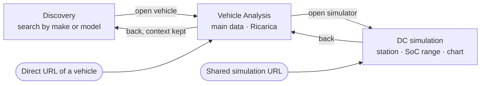

# M0.2 — First vertical slice: Discovery → Vehicle Analysis → DC simulation

| Field  | Value                                                                          |
| ------ | ------------------------------------------------------------------------------ |
| Status | **Defined, not implemented**                                                   |
| Date   | 2026-11-03                                                                     |
| Rules  | [ADR 0001 — Frontend architecture](../decisions/0001-frontend-architecture.md) |

The first functional increment of the frontend. It builds one end-to-end path, small in
features but complete in architecture, to verify that UI, navigation, application state,
visual identity, vehicle data, the M0.1 engine and interactive charts work together.

## 1. Sources

Read before implementing. They take precedence over this document; report any conflict.

- [Product Vision](../product-vision.md) and [UX Design Principles](../ux/design-principles.md).
- Wireframes: [Discovery](../ux/wireframes/consolidated-iteration-1/README.md) (Initial State),
  [Vehicle Analysis](../ux/wireframes/vehicle-analysis-iteration-1/README.md) (From Search,
  Direct Access), [Comparison — Technical Exploration](../ux/wireframes/vehicle-comparison/README.md)
  (layout of conditions, results, chart and assumptions).
- [Livrea Consolidated](../ux/visual-identity/livrea-consolidated/README.md), screens
  `02-discovery.svg` and `04-charging.svg`; [photography](../ux/visual-identity/photography.md).
- M0.1: [public API](../charging/public-api.md), [domain model](../charging/domain-model.md),
  [limitations](../charging/limitations.md).

## 2. Path

## 3. Scope

### Discovery

In scope:

- A small catalogue of fictional vehicles (see [Data](#4-data)).
- Direct search by make or model, updating results as the user types.
- Results as cards: placeholder image, name, body type and seats, list price, peak DC power, each
  with its provenance where the wireframes show it.
- Opening a vehicle's analysis from a result.
- Without a query, the catalogue in price order, as in the Initial State wireframe.

Not in scope: practical and technical criteria, requirements and preferences, near matches,
frequent searches, view modes (Schede/Elenco/Differenze), adding to the comparison, range
estimates. No criterion is to be simulated with arbitrary or technically unjustified results.
Controls for features outside the slice are absent, not shown disabled.

### Vehicle Analysis

In scope:

- The individual page of a vehicle, reachable from Discovery and directly by URL.
- The main information needed by the path: name, body type and seats, version and usable
  capacity, list price, peak AC and DC power, placeholder image.
- The **Ricarica** section: the vehicle's charging data with provenance, the reference DC result
  of the wireframe (10→80 %, 150 kW station) computed by M0.1, and access to the DC simulation
  ("Apri nel simulatore →").
- The context bar: "‹ Risultati" when opened from Discovery, "‹ Cerca" when opened directly, as in
  the Vehicle Analysis wireframes.

Not in scope: other sections (Autonomia e consumi, Spazio e praticità, full Scheda tecnica,
Fonti), fit with criteria, "Verifica con le tue esigenze", comparison actions, version switching,
AC simulation, image gallery, position in the results and "Successivo", the interactive simulator
embedded in the Ricarica section (see [open questions](#9-open-questions)).

### DC simulation

In scope:

- The vehicle being simulated, with a way back to its analysis.
- Station power selection: 50, 150 and 350 kW, as in the wireframes.
- Initial and final SoC as a range ("Livello di carica").
- Calculation with `simulateChargingSession` (DC station, target-SoC termination).
- Results: charging time, energy stored in the battery, SoC interval, each tagged `calcolo`.
- Interactive chart, built with visx, of power by state of charge: the vehicle curve with its
  declared points and linear interpolation, the station limit, the chosen SoC interval, and an
  inspection interaction showing values at a point.
- The assumptions of the calculation, as listed in the wireframes ("Ipotesi").
- A shareable URL that restores the scenario (vehicle, station power, SoC range).
- Defaults when no scenario is given: 150 kW, 10 % → 80 %, as in the wireframes.

Not in scope: AC charging, the "Dopo un tempo" termination (duration sessions), comparison of
several vehicles, the "Energia caricata nel tempo" chart, the "Con altre colonnine" table, the
limiting factor of a session, kilometres added (a range estimate), arbitrary station power values.

## 4. Data

- The catalogue is fictional and illustrative. The UI states this once, globally, as the
  wireframes do ("Dati e veicoli illustrativi"). Fictional data is never presented as verified
  data of real vehicles.
- Reuse the vehicles documented in the wireframes. Two have complete charging data and are
  required:

| Vehicle     | Body, seats        | Price   | Usable capacity | AC max          | DC max | DC curve (SoC %, kW)                                       |
| ----------- | ------------------ | ------- | --------------- | --------------- | ------ | ---------------------------------------------------------- |
| Nordis E4   | SUV medio, 5 posti | €41.500 | 77 kWh          | 11 kW, 3 phases | 175 kW | 0/140, 10/165, 55/175, 65/155, 80/110, 90/70, 100/35       |
| Aurora Vela | Compatta, 5 posti  | €32.900 | 58 kWh          | 11 kW, 3 phases | 135 kW | 0/100, 10/120, 25/135, 40/120, 60/80, 80/40, 90/30, 100/20 |

Sources: [comparison wireframe README](../ux/wireframes/vehicle-comparison/README.md#charging-data-illustrative)
(capacities, curves, AC 11 kW three-phase), Discovery and Vehicle Analysis wireframes (price,
body, DC max).

- Other documented vehicles (Brisa Family, Talon S, Meridian Tour, Nordis E2) may be included
  with their documented values. Any value not documented in the wireframes (for example a DC
  curve for Brisa Family) is a new illustrative value: it must be valid for the M0.1 factories,
  plausible for the vehicle, and recorded with the catalogue data so it can be reviewed.
- Catalogue charging data enters through the M0.1 factories. Invalid data is a catalogue error,
  reported in development, not passed to the engine.
- Every vehicle has a stable identifier used in URLs.

### Provenance and nature of the data

Two properties are kept apart:

- **Provenance kind**: the kind of source a value belongs to, shown with the provenance tags of
  the wireframes and Livrea Consolidated.
- **Nature**: whether the value is real and verified, or illustrative. In the slice every
  catalogue value is **illustrative**: invented for the prototype, about fictional vehicles. No
  manufacturer declared any of it.

| Values in the slice                         | Provenance kind (tag)                      | Nature                                    | Representation                                                                                |
| ------------------------------------------- | ------------------------------------------ | ----------------------------------------- | --------------------------------------------------------------------------------------------- |
| Price, capacity, AC/DC max, DC curve points | Technical specification, `costruttore` (■) | Illustrative                              | Tag as placed in the wireframes; global notice; chart source "del costruttore (illustrative)" |
| Charging time and energy                    | Calculated by M0.1, `calcolo` (◆)          | A real calculation on illustrative inputs | Tag as placed in the wireframes                                                               |
| Estimates                                   | `stima` (○)                                | —                                         | Not used: no estimate model in the slice                                                      |

Convention for the slice:

- In the slice, `costruttore` identifies the **kind** of value (a specification of the type a
  manufacturer declares, as opposed to an estimate or a calculation), not a statement that a real
  manufacturer declared it.
- The illustrative nature is a property of the **whole dataset**, recorded once with the catalogue
  data and stated in the UI as the wireframes do: the global notice ("Dati e veicoli
  illustrativi") and the qualifier "(illustrative)" on the chart source. It is not modelled per
  value.
- Values not taken from the wireframes are illustrative too; they are recorded as such with the
  catalogue data, as required above.
- The visual provenance system (■ `costruttore`, ○ `stima`, ◆ `calcolo`, labels and placement) is
  unchanged. Whether the per-value tag itself should carry the illustrative qualifier is
  [open question 8](#9-open-questions): answering yes would change that system.

- Images are labelled placeholders ("FOTO SEGNAPOSTO · model · view"), following the
  [photography decision](../ux/visual-identity/photography.md) and the Livrea Consolidated
  placeholder. No real photograph is used.

Reference values computed with M0.1 (documented in the wireframes), usable as test oracles:

| Vehicle     | 10→80 % at 50 kW | at 150 kW     | at 350 kW | Energy 10→80 % |
| ----------- | ---------------- | ------------- | --------- | -------------- |
| Nordis E4   | 65 min           | 22 min (22.2) | 20 min    | 53.9 kWh       |
| Aurora Vela | 49 min           | 27 min (27.3) | 27 min    | 40.6 kWh       |

## 5. Navigation

The slice supports:

1. Opening a vehicle directly by URL.
2. Discovery → Vehicle Analysis.
3. Vehicle Analysis → DC simulation.
4. DC simulation → back to the analysis of the same vehicle.
5. Vehicle Analysis → back to Discovery with the same query and, when appropriate, the same
   scroll position.
6. Opening a shared simulation URL directly.

Route paths and parameter names are an implementation choice within the constraints of
[ADR 0001](../decisions/0001-frontend-architecture.md#4-state-management); they are not a
definitive URL schema.

## 6. Architecture in the slice

Build only what the path needs, without shortcuts that contradict ADR 0001:

- The search query and the simulation scenario are owned by the URL. Temporary interaction values
  (a SoC thumb being dragged) are local React state.
- Results and chart series are derived from the scenario and the vehicle on every change; they
  are not stored in Redux or in a cache.
- Scenario models and their parsing and serialisation are framework-independent TypeScript with
  Vitest tests.
- Redux Toolkit is introduced only if the slice has shared state that neither the URL nor a
  component owns. If it is introduced, its ownership is added to the table in ADR 0001.
- Tokens for every Livrea Consolidated value the slice uses are defined centrally before the
  components that use them. Only the components the slice needs are built.
- If Redux is introduced, it is integrated through `react-redux`, as approved in
  [ADR 0001](../decisions/0001-frontend-architecture.md#2-technology-stack).
- The M0.1 engine is used as is. If the chart needs a value the engine does not expose, stop and
  resolve [ADR open question 3](../decisions/0001-frontend-architecture.md#9-open-questions)
  first; do not reimplement engine logic in the UI. The ADR records the approved orientation (pure,
  compatible, tested additions to the public API are admissible); it does not authorise changing
  the engine before that question is decided.

## 7. Acceptance criteria

Each criterion is verifiable on the running app or in tests.

1. **Direct search**
   1. Typing part of a make or model (case-insensitive) shows exactly the matching catalogue
      vehicles; "Nordis" shows every Nordis vehicle in the catalogue and no other.
   2. Results update while typing, with no submit step.
   3. A query with no match shows an empty result state, not an error.
   4. Without a query, all catalogue vehicles are shown in increasing price order.
2. **Opening the vehicle page**
   1. Selecting a result opens that vehicle's analysis.
   2. The vehicle URL opened in a new browser session shows the same page, with "‹ Cerca".
   3. An unknown vehicle identifier shows a not-found state, not a crash.
3. **Simulation configuration**
   1. The station power can be set to 50, 150 or 350 kW; the selected option is the only one
      marked as selected.
   2. Initial and final SoC can be set within 0–100 %; the initial value cannot exceed the final
      one.
   3. Opening the simulation without parameters shows 150 kW and 10 % → 80 %.
4. **Calculation through M0.1**
   1. Results come from `simulateChargingSession`; no charging calculation is reimplemented in
      UI code.
   2. For the scenarios in the [reference table](#4-data), the displayed time and energy match
      the reference values (time rounded to the minute, energy to 0.1 kWh).
   3. Engine results are shown without "~".
   4. An engine error is shown as a message for its error type, never as a raw object or a
      broken page.
5. **Reactive update**
   1. Changing station power or SoC range updates results and chart without a confirmation step.
   2. Dragging a SoC thumb does not create a browser history entry per intermediate value.
6. **DC curve chart**
   1. Declared curve points are visually distinct from the interpolated segments.
   2. The station limit is shown, and the curve above it is distinguishable from the power
      actually received.
   3. The chosen SoC interval is shown on the chart and follows the controls.
   4. Axes carry units (kW, %), and the vehicle's colour and marker come from its slot tokens.
   5. Inspecting a point shows the SoC and power at that point.
7. **URL reproducibility**
   1. Copying the simulation URL into a new browser session restores vehicle, station power and
      SoC range, with identical results.
   2. A URL with missing or invalid parameters opens a working page (defined defaults or a clear
      message), never a crash.
   3. Scenario serialisation round-trips in unit tests.
8. **Navigation continuity**
   1. From the simulation, the return link leads to the same vehicle's analysis.
   2. From an analysis opened via Discovery, "‹ Risultati" restores the query and results; the
      browser's Back button gives the same result.
   3. Tooltips, hover states and open menus are not restored after navigation.
9. **Data and provenance**
   1. Every catalogue specification shown carries `costruttore`; every engine result carries
      `calcolo`, following the wireframe placement and the [convention](#provenance-and-nature-of-the-data)
      of this slice.
   2. The illustrative nature of the data is stated globally and on the chart source
      ("(illustrative)"); no value is presented as declared by a real manufacturer.
   3. No estimate is shown without a model (no range or kilometres added).
   4. All catalogue charging data passes the M0.1 factories (tested).
   5. Images are labelled placeholders.
10. **Livrea Consolidated**
    1. Colours, type, spacing, radii and states come from central tokens; components contain no
       raw colour values.
    2. Schibsted Grotesk is the only typeface.
    3. Yellow marks only scenario parameters and their effects (station option, SoC range, chart
       interval and station plate); view options, navigation and actions are ink.
    4. The vehicle colour appears only with its slot number or marker shape.
    5. At 1440 px, the screens match the structure of the reference wireframes and Livrea
       screens for the parts in scope.
11. **Accessibility of implemented interactions**
    1. Search, result links, station options, SoC range, chart inspection and return links work
       with keyboard alone, with a visible focus indicator.
    2. Controls have accessible names; the SoC thumbs announce their values.
    3. Chart values are also available as text (results and a text equivalent of the inspected
       point), and information is never conveyed by colour alone.
    4. Text meets the contrast ratios documented for Livrea Consolidated.
    5. The document language matches the Italian product copy.
12. **Tests and regressions**
    1. `npm test`, `npm run typecheck`, `npm run lint` and `npm run build` succeed.
    2. Existing M0.1 tests are unchanged and pass; M0.1 behaviour is unchanged.
    3. New pure modules (scenario codec, catalogue validation, search matching) have Vitest tests.
    4. No dependency outside the approved stack is added.

## 8. Implementation activities

Indicative order. These are not acceptance criteria and may be adjusted.

1. Install the stack packages the slice needs (Redux Toolkit and `react-redux` only if the slice
   introduces Redux).
2. Define the Livrea Consolidated tokens used by the slice and load Schibsted Grotesk.
3. Create the illustrative catalogue, validated through the M0.1 factories, with tests.
4. Model the search and simulation scenarios and their URL parsing and serialisation, with tests.
5. Build Discovery with search and results.
6. Build Vehicle Analysis with the context bar and the Ricarica section.
7. Build the DC simulation: controls, results, assumptions.
8. Build the visx power-by-SoC chart and its accessible inspection.
9. Verify the navigation scenarios and the acceptance criteria; update the README status.

## 9. Open questions

Undecided. Each must be discussed and approved before the part of the slice it affects is built;
describing how to approach a question does not resolve it. Questions 1–4 and 6 are also listed in
[ADR 0001](../decisions/0001-frontend-architecture.md#to-decide-before-implementing-the-first-vertical-slice).

1. **Single-vehicle simulation layout.** No wireframe shows a dedicated simulation for one
   vehicle. The slice combines the single-vehicle simulator of Vehicle Analysis (controls and
   chart) with the dedicated view of Comparison — Technical Exploration (results, assumptions,
   return link). Confirm this composition.
2. **Inline simulator in Ricarica.** The Vehicle Analysis wireframe embeds an interactive
   simulator in the Ricarica section and also offers "Apri nel simulatore →". Whether the slice
   needs the inline version, and whether the two share one component, is not decided.
3. **Values the chart needs that M0.1 does not expose** (ADR open question 3), in particular the
   effective power at a SoC (curve capped by vehicle and station maximum), needed to draw "power
   received" against the station limit. The limiting factor of a session is out of scope for the
   slice. The ADR records the approved orientation; which values the engine exposes, and how, is
   not decided.
4. **SoC granularity** (integer percent or finer) and the handling and presentation of an empty
   interval (initial = final, which M0.1 treats as a zero session).
5. **Search matching rules** beyond make and model substrings (accents, separators such as "E4"
   vs "E 4").
6. **Synchronisation of parameters, URL and history** for station and SoC changes (ADR
   [Decision 2](../decisions/0001-frontend-architecture.md#decision-2--reactive-updates) and open
   question 5): when a temporary value becomes committed, when the URL is rewritten, and which
   changes push a history entry rather than replacing the current one. Acceptance criterion 5.2 is
   a constraint on the answer, not the answer.
7. **Copy of the return link** from the simulation to the analysis.
8. **Illustrative qualifier on provenance tags.** Whether the global notice and the chart source
   are enough, as in the wireframes, or each `costruttore` tag must also say the value is
   illustrative. A per-value qualifier would change the provenance system of the wireframes and
   Livrea Consolidated, and needs a design decision.
