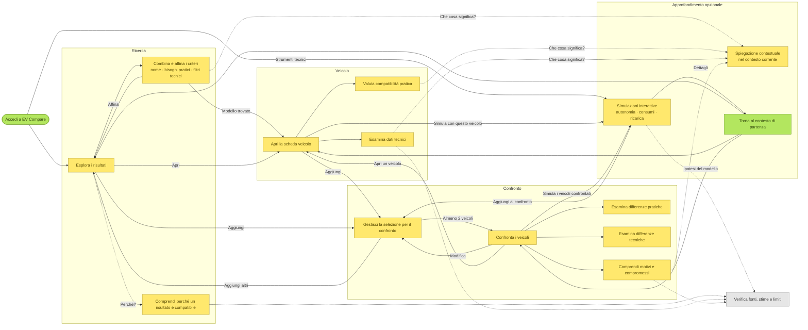

# EV Compare — Revisione critica dei flussi utente

Revisione indipendente di [`user-flow-overview.mmd`](user-flow-overview.mmd) e [`user-flow-overview.md`](user-flow-overview.md) rispetto a [`product-vision.md`](../product-vision.md). La board Miro non è stata consultata; la revisione si basa sul sorgente Mermaid del repository.

Stato: proposta da discutere. I file della mappa dei flussi non sono stati modificati.

## A. Valutazione complessiva: pronta dopo modifiche mirate

Il documento `.md` è solido. Le sue "Proposed UX decisions" sono quasi tutte in linea con la Product Vision: un unico spazio di ricerca, la parte pratica e quella tecnica come due "lenti" parallele, l'aggiunta al confronto anche dai risultati, la ricerca senza modalità separate.

Il problema principale è che **il diagramma non segue le decisioni scritte nel suo stesso documento**. Mostra un bivio iniziale tra modalità, una sequenza obbligata (risultati → scheda → confronto) e strumenti tecnici raggiungibili solo alla fine del confronto. Chi disegnerà i wireframe partirà dal diagramma, non dalle note, quindi questo scarto va corretto.

La struttura generale è buona. Non serve rifarla da capo: servono interventi su circa sei punti.

## B. Problemi individuati

### 1. Il bivio iniziale si comporta come un questionario e separa le modalità di ricerca — Critica

- **Elementi interessati:** `B {Da dove vuoi iniziare?}`, i rami verso `C`, `D1` e `D2`, e i collegamenti `G → C/D1/D2`.
- **Motivazione:**
  - Il primo passo dopo l'ingresso è una domanda, mentre la Vision chiede che *"the primary interface should expose meaningful search and filtering capabilities, without requiring preliminary interaction"* (§4, §3.1).
  - I tre rami fanno sembrare la ricerca per nome, quella per bisogni e quella tecnica come alternative da scegliere in anticipo. Il `.md` dice il contrario ("criteria can be combined").
  - Il ciclo `G → C/D1/D2` rafforza questa separazione: per correggere la ricerca si torna a scegliere un ramo.
- **Correzione:** eliminare `B`. L'ingresso porta direttamente a uno spazio di ricerca dove testo, bisogni pratici e filtri tecnici sono criteri combinabili, raccolti in un solo nodo. L'accesso diretto agli strumenti tecnici resta come seconda porta d'ingresso.

### 2. Il passaggio "I risultati sono utili?" crea un percorso lineare — Importante

- **Elementi interessati:** `F`, `G`, `F → Sì → H`.
- **Motivazione:**
  - Affinare i criteri è un'attività continua, fatta insieme alla lettura dei risultati. Non è una verifica da superare prima di aprire una scheda.
  - L'esperto che conosce già il modello percorre `A → B → C → E → F → H`: quattro passaggi, tra cui due domande, per arrivare alla scheda.
- **Correzione:**
  - Sostituire `F` e `G` con un ciclo `Esplora risultati ⇄ Combina e affina i criteri`.
  - Aggiungere un collegamento diretto dalla ricerca per nome alla scheda veicolo.

### 3. Il confronto è l'ultima tappa di un percorso, non una funzione centrale — Importante

- **Elementi interessati:** `H → L`, `L → M`, `M`, `N → E`, e la mancanza di collegamenti `E → L` e `O → H`.
- **Motivazione:**
  - L'unica strada verso il confronto passa dalla scheda veicolo. Il `.md` ammette l'aggiunta dai risultati, ma il diagramma non la mostra.
  - `M {Hai abbastanza veicoli?}` presenta come decisione dell'utente quella che è una regola dell'interfaccia (servono almeno due veicoli).
  - Dal confronto non si può aprire la scheda di un veicolo, né togliere un veicolo dal confronto.
  - La Vision mette il confronto tra le funzioni disponibili subito (§3.1) e chiede di poter *"return to their original comparison"* (§4.5).
- **Correzione:**
  - Introdurre un nodo `Gestisci la selezione per il confronto` (aggiungi o rimuovi), raggiungibile dai risultati, dalla scheda e dal confronto stesso.
  - Eliminare `M`; la regola dei due veicoli diventa l'etichetta di un collegamento.
  - Aggiungere `Confronto → Scheda veicolo`.

### 4. Gli strumenti tecnici non si raggiungono dalla scheda e sono bloccati dietro "Vuoi approfondire?" — Importante

- **Elementi interessati:** `S`, `S → No → O`, `T2`, e la mancanza di un collegamento `H → T`.
- **Motivazione:**
  - Dal confronto si arriva alle simulazioni solo dopo aver attraversato `O → P/Q → R → S`.
  - Dalla scheda veicolo, che è il contesto più naturale per simulare la ricarica di quel modello, non c'è nessun collegamento.
  - `T2 Configura veicolo e scenario` è un passo obbligato prima di simulare. Quando si parte da una scheda o da un confronto, il veicolo è già noto. Lo scenario dovrebbe essere parte della simulazione e modificabile mentre la si usa: è proprio così che si impara interagendo (§3.4).
- **Correzione:**
  - Eliminare `S`.
  - Aggiungere i collegamenti `Scheda → Simula con questo veicolo` e `Confronto → Simula i veicoli confrontati`.
  - Unire `T2` alla simulazione stessa.

### 5. La trasparenza appare come un passaggio della scheda invece che come qualità di tutti i dati — Importante

- **Elementi interessati:** `K`, `I → K → L`, `J → K → L`.
- **Motivazione:**
  - `K` sta *prima* dell'aggiunta al confronto, come se andasse attraversato.
  - Fonti, stime e limiti riguardano anche i risultati, il confronto e soprattutto le simulazioni, che si basano su ipotesi di modello.
  - Manca il "perché questo veicolo è compatibile" proprio nel punto in cui il sistema raccomanda, cioè nei risultati ottenuti da bisogni pratici (§3.6).
- **Correzione:**
  - Trasformare `K` in un nodo trasversale, collegato con linee tratteggiate (consultazione facoltativa) dai risultati, dai dati tecnici, dal confronto e dalle simulazioni.
  - Aggiungere `Comprendi perché un risultato è compatibile` nell'area della ricerca.

### 6. Il ritorno al contesto è ambiguo e la spiegazione è trattata come una navigazione — Minore

- **Elementi interessati:** `T1 → U`, `U → E/H/O`.
- **Motivazione:**
  - La regola da fissare a livello concettuale è questa: **una spiegazione contestuale non fa lasciare l'attività in corso**, quindi non ha bisogno di un ritorno.
  - Le simulazioni invece si aprono e si chiudono, e quando si chiudono riportano al punto di partenza con filtri, selezione e scenario intatti.
  - Il nodo `U` che porta a tre destinazioni non chiarisce che si torna *al punto da cui si era partiti*.
  - Chi entra direttamente negli strumenti non ha un punto di partenza, ma deve poter usare il risultato: aprire la scheda o aggiungere il veicolo al confronto.
- **Correzione:**
  - `T1` senza ritorno, con la nota "si apre nel contesto corrente".
  - Dalla simulazione: un collegamento verso il confronto e il ritorno al punto di origine.
  - **Come** si mantiene lo stato (pannello, overlay, stato nell'URL) è un dettaglio di realizzazione da rimandare.

### 7. Livello di dettaglio non uniforme — Minore

- **Elementi interessati:** `T3`, `T4`, `P → R`, `Q → R`.
- **Motivazione:**
  - `T3` e `T4` fissano due strumenti specifici, mentre il `.md` lascia aperta la scelta (domanda 5).
  - `P/Q → R` fa sembrare "motivi e compromessi" il punto d'arrivo obbligato delle due lenti.
  - Le spiegazioni non si possono aprire dai criteri di ricerca. Chi usa i filtri tecnici senza conoscerli bene, per esempio "kW DC", ne avrebbe bisogno.
- **Correzione:**
  - Un solo nodo `Simulazioni interattive (autonomia, consumi, ricarica…)`.
  - `P`, `Q` e `R` come lenti parallele, ognuna raggiungibile direttamente da `O`.
  - Un collegamento tratteggiato `Criteri → Spiegazione`.

## C. Aspetti da preservare

- Nessun onboarding e nessun questionario prima dell'accesso.
- Tutte le modalità di ricerca confluiscono in **un solo insieme di risultati** (`E`).
- Pratica e tecnica come **lenti parallele** (`I`/`J`, `P`/`Q`), non come livelli in sequenza.
- Gli approfondimenti indicati con linee tratteggiate, cioè come facoltativi.
- L'accesso diretto agli strumenti tecnici dall'ingresso.
- Il ritorno esplicito al contesto come comportamento del prodotto, non affidato al tasto "indietro" del browser.
- `R Comprendi motivi e compromessi`: il confronto aiuta a giudicare, non sceglie un vincitore.
- Le aree del diagramma servono solo a organizzare la discussione, non corrispondono a pagine.
- Quasi tutte le "Proposed UX decisions" del `.md`.

## D. Modifiche consigliate, in ordine di priorità

1. Eliminare `B` e unire `C`/`D1`/`D2` in un solo nodo di criteri combinabili; l'ingresso porta direttamente ai risultati (problema 1).
2. Sostituire `F`/`G` con il ciclo risultati ⇄ criteri e aggiungere il collegamento ricerca per nome → scheda (problema 2).
3. Introdurre la selezione per il confronto raggiungibile da risultati, scheda e confronto; eliminare `M`; aggiungere `O → H` (problema 3).
4. Eliminare `S`; collegare le simulazioni da scheda e confronto; unire `T2` alla simulazione (problema 4).
5. Rendere `K` trasversale e aggiungere il "perché è compatibile" nei risultati (problema 5).
6. Separare la spiegazione nel contesto corrente dalla simulazione con ritorno all'origine (problema 6).
7. Rendere il dettaglio uniforme: un solo nodo per le simulazioni, P/Q/R come lenti parallele, spiegazioni dai criteri (problema 7).
8. Allineare il `.md`: oggi la sezione "Review against the Product Vision" dichiara proprietà che il diagramma non ha, per esempio *"Non-linear navigation"*.

## E. Decisioni di prodotto da prendere prima dei wireframe

Delle otto domande aperte nel `.md`, solo quattro bloccano i wireframe. Le altre (contenuti dei bisogni pratici, provenienza dei dati, limite di veicoli, persistenza tra visite, differenze regionali) si possono decidere dopo.

1. **Cosa si vede all'ingresso**
   - *Catalogo completo con criteri accanto:* l'utente capisce subito cosa offre il prodotto e può esplorare anche senza una domanda precisa, ma all'inizio la lista è poco pertinente.
   - *Spazio di ricerca vuoto:* la ricerca è più mirata, ma c'è il rischio che diventi di fatto un "prima dimmi cosa cerchi".
2. **I bisogni pratici filtrano o ordinano per compatibilità?** (riprende la domanda 3)
   - *Solo filtro:* più semplice e trasparente, ma non distingue un veicolo appena accettabile da uno molto adatto.
   - *Indicatore di compatibilità:* più utile, ma richiede di spiegare i criteri per ogni veicolo e di permettere di modificarli. Influisce sulla struttura di `E` e di `R`.
3. **Com'è fatta la selezione per il confronto**
   - *Selezione sempre visibile in ogni contesto:* rende il confronto davvero centrale e facilita la continuità tra attività.
   - *Selezione costruita dentro la vista di confronto:* più semplice, ma rimanda il confronto alla fine del percorso. Influisce sulla struttura di quasi ogni schermata.
4. **Strumento aperto senza veicolo** (riprende la domanda 6)
   - *Esempio generico:* si inizia subito, ma va presentato chiaramente come esempio.
   - *Scelta del veicolo:* aggiunge un passaggio.
   - *Inserimento manuale delle caratteristiche:* l'opzione più flessibile per l'esperto, ma la più difficile per chi è alle prime armi.
   - Una combinazione è possibile: si parte dall'esempio e il veicolo si può cambiare in qualunque momento.

## F. Diagramma revisionato

**Nodi di decisione: da 4 a 0.** È voluto: tutti e quattro erano regole dell'interfaccia (`M`) o domande non necessarie (`B`, `F`, `S`). Le scelte vere restano all'utente e sono rappresentate dai collegamenti. **Nodi di attività: da 23 a 16**, con lo stesso livello di astrazione dell'originale.
