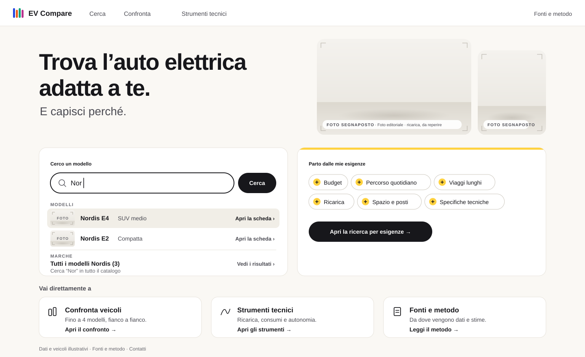

# Livrea Consolidated

_Iteration 3. One synthesis of Livrea Refined and Livrea Expressive. A proposal to validate, not an approved identity._

| Screen                              | File                                     |
| ----------------------------------- | ---------------------------------------- |
| Identity sheet                      | [`00-identity.svg`](00-identity.svg)     |
| Landing Page                        | [`01-landing.svg`](01-landing.svg)       |
| Vehicle Discovery — Active Criteria | [`02-discovery.svg`](02-discovery.svg)   |
| Comparison — Selected Vehicles      | [`03-comparison.svg`](03-comparison.svg) |
| DC charging curves                  | [`04-charging.svg`](04-charging.svg)     |

## Goal of the synthesis

Keep what made [Livrea Refined](../livrea-refined/README.md) preferred (lightness, Schibsted Grotesk, clean surfaces, components, legible dense screens, tables, balanced composition) and add what made [Livrea Expressive](../livrea-expressive/README.md) preferred (a livelier palette with cobalt, yellow as part of the identity, more colour character). Expressive's colours were not dropped onto Refined's components: the two palettes served different semantic systems, so the colour roles were redesigned for Refined's structure.

Generator: [`../_source/livrea-consolidated.mjs`](../_source/livrea-consolidated.mjs), built from the Refined module. Same content, scenarios and data as all previous concepts ([`../_source/content.mjs`](../_source/content.mjs)).

## Kept from Refined

- Layout and coordinates of all four screens, so the side-by-side comparison in the review page lines up.
- Light page `#FAF8F4`, white cards with hairline borders, 12–18 px radii, pill buttons and fields.
- Schibsted Grotesk as the only family, same hierarchy.
- Hairline comparison table, values in one column per vehicle, provenance column (■ `costruttore`, ○ `stima`, ◆ `calcolo`), the zero-based scale in "Altre differenze".
- Numbered vehicle badges and the four marker shapes (circle, square, triangle, diamond) as the non-colour identity.
- Charts: manufacturer curve points with stated linear interpolation, hatched region above the station's power, dotted unreachable part of the curve, hover state at 20 minutes.

## Taken from Expressive

- The vehicle palette, unchanged: 1 Cobalto `#2548E0`, 2 Mandarino `#E8601C`, 3 Smeraldo `#11A37A`, 4 Magenta `#B8338E`.
- Signal yellow `#FFD23F` and its tint `#FFF4C7`, with a narrower meaning (below).
- Ink as the action colour: near-black buttons and active states instead of a coloured interface accent.
- Yellow tabs on active criteria, the yellow plate as a container for a user-set value, the station plate on the chart.
- A staggered second frame in the landing photography, at Refined's scale.

## Colour system

Four families. A colour from one family never does another family's job.

| Family        | Tokens                                                                                        | Job                                                                                                     |
| ------------- | --------------------------------------------------------------------------------------------- | ------------------------------------------------------------------------------------------------------- |
| Interface     | Inchiostro `#17171B`, Pagina `#FAF8F4`, Bianco, Filo `#CBC6BC`, Velo `#F1EEE7`                | Text; actions, links, active navigation, view toggles, focus (ink); hover rows and neutral fills (Velo) |
| Your scenario | Giallo targa `#FFD23F`, Giallo tenue `#FFF4C7`                                                | What you have set that changes the results, and the effect of those settings                            |
| Vehicles      | 1 Cobalto `#2548E0`, 2 Mandarino `#E8601C`, 3 Smeraldo `#11A37A`, 4 Magenta `#B8338E`         | Identity in the comparison, always with the slot number or marker shape                                 |
| Signals       | Attenzione `#8F5300` on white; Critico `#B3261E` on `#FBEAE8`; Informazione `#4A4A52` on Velo | States, always with an icon and words                                                                   |

Why the interface is no longer blue: Refined's Blu inchiostro `#1E2A78` would sit next to Cobalto, the colour of vehicle 1, and a user could read a blue button or a blue focus ring as "about vehicle 1". Ink removes the ambiguity and keeps surfaces calm. Links are distinguished by weight 600 plus an arrow or chevron when the copy has one, and by an underline otherwise ("Azzera", "Annulla", "Modifica criteri", "Vedi le differenze", "Rendi flessibile …").

Why attention has no tint: Refined's attention tint `#FBF1DD` is too close to Giallo tenue. Attention is brown text with a triangle on a plain surface, so yellow can never be read as a warning.

Rules:

- A vehicle colour appears only with its number (badge) or its marker shape (charts): badge, 4 px rule under a card photo or a comparison header photo, outline of the "Nel confronto" button, 4 px edge of a result card, chart line, dot on a scale.
- Vehicle colours never colour text and never fill columns or large areas.
- Vehicles outside the comparison are neutral.
- Yellow always comes with ink: ink text on it, an ink outline, ink handles, or an ink rule next to it.
- Exception: the logo uses the four slot colours, as in Refined. It is a mark, not an identity indicator.

Contrast (WCAG): ink on Giallo 12.4:1, on Giallo tenue 16.2:1; secondary text `#4A4A52` on Giallo tenue 8.0:1; notes `#68686F` 5.2:1 on the page; Critico 6.5:1 on white, 5.6:1 on its tint; Attenzione 6.2:1 on white; numbers on slot colours: white on Cobalto 6.8:1, ink on Mandarino 5.2:1, ink on Smeraldo 5.6:1, white on Magenta 5.4:1. Chart lines against the white chart cards: Cobalto 6.8:1, Mandarino 3.4:1, Smeraldo 3.2:1, Magenta 5.4:1 (all ≥ 3:1 for graphical objects). Yellow on the page is only 1.4:1, which is why it never stands alone as a boundary.

Colour vision: the four vehicle colours pass the colour-vision validator on all pairs against the page (worst pair Magenta–Smeraldo, deutan ΔE 10.0; normal-vision floor 21.2). Adding Critico to the set still passes; its closest neighbour is Magenta (normal-vision ΔE 15.2, at the floor), which is acceptable because signals always carry an icon and words and never mark a vehicle.

## Yellow

**Meaning.** Expressive's rule was "yellow = what you have set", and it coloured every selected segment, including view toggles. That rule is too broad: almost every control is set by the user, so yellow drifted towards "selected", competing with ink. The consolidated rule is narrower and easier to keep:

> Yellow marks the parameters of your scenario, the ones that change the results (criteria, criterion behaviour, charging conditions, the charging interval), and the effect of those parameters. How you look at the results (Schede/Elenco/Differenze, Tabella/Grafico, Tutte/Solo differenze), navigation and actions stay ink.

**Two studies** in the identity sheet use identical components and content:

| Element                                                                     | A · discreet        | B · characterising      |
| --------------------------------------------------------------------------- | ------------------- | ----------------------- |
| Tab on active criteria                                                      | yellow              | yellow                  |
| Selected scenario option (behaviour, station, charge type, end of charging) | yellow, ink outline | yellow, ink outline     |
| Charging interval on the chart axis                                         | yellow bar          | yellow bar              |
| Criteria count ("Criteri attivi 6", "6 criteri" in the context bar)         | text                | yellow plate            |
| Notice reporting the effect of the last change                              | neutral, info icon  | yellow tint and tab     |
| Range sliders (DC power minimum, charge level)                              | ink fill            | yellow fill             |
| Station limit on the chart                                                  | text                | yellow plate            |
| Interval band in the chart, chosen station row in the table                 | none / neutral      | pale yellow             |
| Landing: needs card and its "+" chips                                       | neutral             | yellow top rule and "+" |
| Comparison: "Con i tuoi criteri"                                            | —                   | yellow tab              |

**Applied to the screens: B.** Reasons:

1. The landing has no vehicles selected. With A it would carry no yellow at all and its identity would rest on the logo and photos, which is Refined's weakest point. B gives it one functional yellow element: the place where you start setting your needs.
2. In B yellow follows your scenario across discovery (criteria, count, notice), comparison (count in the context bar, the criteria section) and simulation (conditions, interval, station). That continuity is useful, not decorative.
3. Every yellow element in B is small: tabs, plates, a slider track, a 5 px rule, pale bands. No yellow card, column or bar wider than a table row. The page stays as light as Refined's.

A remains a valid fallback if B proves too insistent in use; the components are the same, only tier-2 elements change (one parameter in the generator).

## Typography

Schibsted Grotesk (OFL), embedded. Unchanged from Refined: headings 700 at 56 / 32 / 26 / 20 with tight tracking, text and labels 400–600 at 12–17. Tabular figures only on chart axes and in the stations table, because Schibsted's tabular set widens `.`, `,` and `:` in prices and decimals. Underlined links are new (consequence of the ink interface). No other family was introduced; Anybody, IBM Plex and Archivo were not reconsidered, as requested.

## Photography

Refined's approach: real photographs of the correct model, integrated at moderate size, rounded like the cards, never under text. The landing borrows Expressive's staggered composition with a second, narrower frame (380 × 236 and 168 × 208). All images are still **labelled placeholders**; the scenario vehicles are illustrative (see [`../photography.md`](../photography.md)).

The placeholder is new for this concept: instead of a flat field with a camera icon it shows the intended set (light studio wall, floor line at two thirds of the height, soft ground shadow where the car will stand, crop marks) and a label pill "FOTO SEGNAPOSTO · model · view". It previews how real photos should be framed while staying obviously a placeholder. No vehicle is drawn. The shared `photoSlot` in `lib.mjs` is unchanged, so earlier concepts rebuild identically.

## Screens

- **Landing.** Refined's layout. Identity without vehicles: logo, Schibsted headline, ink actions, the yellow needs card, the photo composition.
- **Discovery.** Six thin yellow criteria tabs, the "6" plate, a yellow slider and behaviour toggle in the open criterion, the yellow notice. Results cards: 4 px slot rule under the photo, badge on the photo, slot-coloured outline on "Nel confronto"; Brisa Family stays neutral. View toggle and primary actions in ink.
- **Comparison.** Neutral hairline table, no coloured columns. Colour only in the header (4 px slot rule under each photo, badge next to the name) and in the badges of "Altre differenze". "6 criteri" in a yellow plate in the context bar; a yellow tab beside "Con i tuoi criteri". The hover row is Velo.
- **Charging.** Conditions in yellow (they are your scenario); curves in Cobalto and Mandarino with marker shapes and direct labels; interval as a yellow bar on the axis plus a pale band; station limit as an ink dashed line with a yellow plate above it; hatched region and dotted unreachable curve as in Refined; neutral crosshair and tooltip. The chosen station row in "Con altre colonnine" is pale yellow.

## Trade-offs

- Ink links are less discoverable than coloured links; underlines and arrows compensate, at the cost of a little visual noise.
- Yellow tier 2 adds about ten small yellow elements per dense screen. Each has a reason, but together they need restraint in future screens.
- Removing the attention tint makes warnings quieter than in Refined.
- The pale chart band and the pale table row rely on a 1.1:1 tint difference; the yellow axis bar and the "150 kW" label carry the information when the tint is not perceived.
- Numbered badges were kept over Expressive's stripe counts: more self-evident, less characteristic.

## To validate

1. Yellow intensity B in use, with real users and longer sessions; whether A is enough.
2. The scenario/view distinction: will people perceive why "150 kW" is yellow and "Tabella" is ink? It should not need explaining; if it does, the rule is wrong.
3. Underlined ink links versus a coloured link style.
4. Smeraldo's contrast on the page (3.0:1) for thin lines placed outside white cards; Mandarino next to the Critico red in any future screen that shows both.
5. The landing's personality once real photography exists.
6. Mobile minimum sizes for 4 px rules, badges and tabs; dark theme (still not designed).
