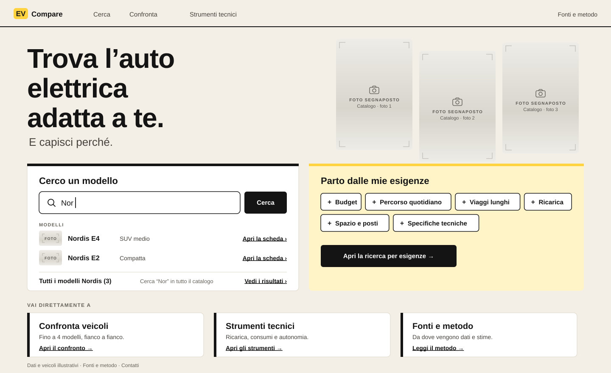

# Livrea Expressive

_Iteration 2, variant B. The livery as a visual language._

| Screen                              | File                                     |
| ----------------------------------- | ---------------------------------------- |
| Identity sheet                      | [`00-identity.svg`](00-identity.svg)     |
| Landing Page                        | [`01-landing.svg`](01-landing.svg)       |
| Vehicle Discovery — Active Criteria | [`02-discovery.svg`](02-discovery.svg)   |
| Comparison — Selected Vehicles      | [`03-comparison.svg`](03-comparison.svg) |
| DC charging curves                  | [`04-charging.svg`](04-charging.svg)     |

## Core idea

Push Livrea further, but move the boldness from mass (black blocks, coloured columns) to **language**: racing liveries, number plates, stripes, typefaces that change width. The result should be recognisable on any screen, including ones without a comparison, while the technical screens keep a calm table structure.

Three devices carry the identity:

- **Livery = colour + stripes.** Each compared vehicle has a colour and a number of stripes equal to its slot (1–4). The stripes are visible in greyscale, in print and for colour-blind users.
- **Signal yellow = what you have set.** Active criteria (yellow tab), the criteria count, selected options, the charging interval, the chosen station, the comparison count, the context bar that carries your criteria, the notice that reports the effect of your last change.
- **Width as hierarchy.** Anybody expanded for headings, Anybody condensed for figures, Overpass for reading.

## Colour system

| Family        | Tokens                                                                                                       | Job                                                                                      |
| ------------- | ------------------------------------------------------------------------------------------------------------ | ---------------------------------------------------------------------------------------- |
| Interface     | Inchiostro `#141414`, Carta `#F3EFE6`, Bianco, Lavatura `#ECE7DC`                                            | Text, actions (ink buttons), outcomes (ink plate for "3" results), neutral states, hover |
| Your settings | Giallo targa `#FFD23F`, Giallo tenue `#FFF4C7`                                                               | Criteria, conditions, selections, effects of your changes                                |
| Vehicles      | 1 Cobalto `#2548E0`, 2 Mandarino `#E8601C`, 3 Smeraldo `#11A37A`, 4 Magenta `#B8338E`, each with 1–4 stripes | Identity in the comparison                                                               |
| Signals       | Attenzione `#8F5300` on `#FBF1DD`; Critico `#B3261E` on `#FBEAE8`                                            | States, with icon and words                                                              |

Contrast: ink on yellow 12.8:1; white on Cobalto 6.8:1, ink on Mandarino 5.4:1, ink on Smeraldo 5.7:1, white on Magenta 5.4:1; notes `#66635B` 5.2:1 on paper. Yellow against paper is only 1.3:1, so yellow is never a boundary on its own: selected segments also have an ink outline and a heavier label, criteria keep their border.

Vehicle colours may fill **bands** (under a card photo, under a comparison header photo, result headers, chart end tags). They never colour body text and never fill whole columns. Yellow is never a warning: warnings are brown with a triangle icon.

## Vehicle identity (section 5 of the brief)

- **Assignment:** lowest free slot; the vehicle gets that colour and that many stripes.
- **Removal:** frees the slot; others keep colour and stripes.
- **Adding after a removal:** fills the freed slot (identity sheet: Talon S gets two stripes after Aurora Vela leaves).
- **Three or four vehicles:** bands stay in the header and under photos; table cells remain neutral. Stripe count distinguishes slots 3 and 4 even if colour does not.
- **Chart series:** colour + marker shape (circle / square alternating) + end tags with stripes and name.
- **Not yet selected:** neutral wash band under the photo, no colour, no stripes.
- **Single-vehicle analysis:** neutral ink identity; the vehicle's livery band appears only if it is in the comparison. The yellow system still works there (your scenario settings).
- **Coexistence with signals:** signals use icons and darker tones; yellow means settings, not warnings.

## Typography

- **Anybody** (OFL, variable width 50–150 %, weight 100–900), embedded. Expanded 140 % / 850 for page and section headings; 115 % / 700 for vehicle and card titles; condensed 62 % / 750 with tabular figures for prices, charging times, chart axes and the stations table. The width axis gives one family two voices: wide and loud for headings, narrow and compact for figures in dense places.
- **Overpass** (OFL), embedded, for body text, labels and table values. Derived from Highway Gothic, the US road-sign lettering: legible at small sizes and connected to the road theme without being a pastiche.

Condensed figures are used for **single numbers**, not phrases: comparison values ("1 sosta di ~22 min") are set in Overpass 16/700 for legibility.

Atkinson Hyperlegible Next was tried for body text and dropped: its zero is always slashed, which made prices and thresholds ("€45.000", "400 L") noisy.

## Composition

- Asymmetric landing: a three-line expanded headline, three tall photographs as a staggered strip, the search card with an ink top rule, the needs card in yellow wash.
- Cards with 8 px radius, hairline border, photos full-bleed at the top; ink left rules on link cards instead of black blocks.
- Results header: an ink plate with the count beside an expanded title.
- Comparison: photo + livery band (colour, stripes, name) per column, then a neutral hairline table; provenance glyphs in a fixed column; livery bars from zero in "Altre differenze", ending with the stripes.

## Photography

Photographs are composition elements: three tall frames on the landing, full-bleed card tops (330 × 176), comparison headers (300 × 132), thumbnails. The livery band sits **under** the photo, never over it, so the car is never covered. All images are currently **labelled placeholders**; see [`../photography.md`](../photography.md).

## Technical visualisation

- Lines 3 px in slot colour, markers on manufacturer curve points, interpolation stated.
- Your settings in yellow: the 10→80 % band, the "colonnina 150 kW" plate on the station line, the selected options.
- The region above the station's power is hatched; Nordis E4's curve inside it is dotted.
- End tags in slot colour with stripes; 20-minute values as tags on both lines, an ink plate "20 min" on the crosshair.
- Results: a livery header band with name, the time in condensed 64 px.
- Axes in condensed figures, so ticks stay compact.

## Motion and interaction

Adding a vehicle "paints" the livery band from left to right under the photo (250 ms) and drops a stripe chip into the tray; removing it wipes the band. Changing a criterion briefly pulses its yellow tab and the yellow notice reports the effect. In charts, hovering a vehicle keeps its line at full strength and fades the others; the end tag follows the cursor. No decorative motion.

## Strengths

- The most recognisable direction so far, and recognisable outside the comparison (headings, plates, stripes, yellow).
- Colour is used creatively but each colour has one meaning; identity survives without colour.
- Yellow makes the user's own inputs visible across search, comparison and simulation, which supports continuity.
- The comparison table stays calm: expressive elements are confined to headers, bands and big numbers.

## Limits and risks

- Expanded type is space-hungry: headings must be short, long names need truncation rules, mobile needs a narrower setting.
- More conventions to learn (stripes, yellow vs ink plates). They must be self-evident in use, not explained in copy.
- The yellow semantics are strict; any later use of yellow for something else breaks them.
- Two variable families and more bespoke components cost more to build than Refined.
- Large photos raise the bar for image quality and consistency.

## Implementation considerations

- Two self-hosted OFL families; Anybody needs `font-stretch` support (all evergreen browsers) and a fallback width strategy.
- Slot state as in Refined, plus stripe rendering in chips, bands, tags and legends.
- Yellow as a semantic token ("user setting"), not a brand colour usable anywhere.
- Charts need custom end tags and per-slot markers.
- Photography pipeline as in [`../photography.md`](../photography.md); full-bleed crops need consistent framing.
