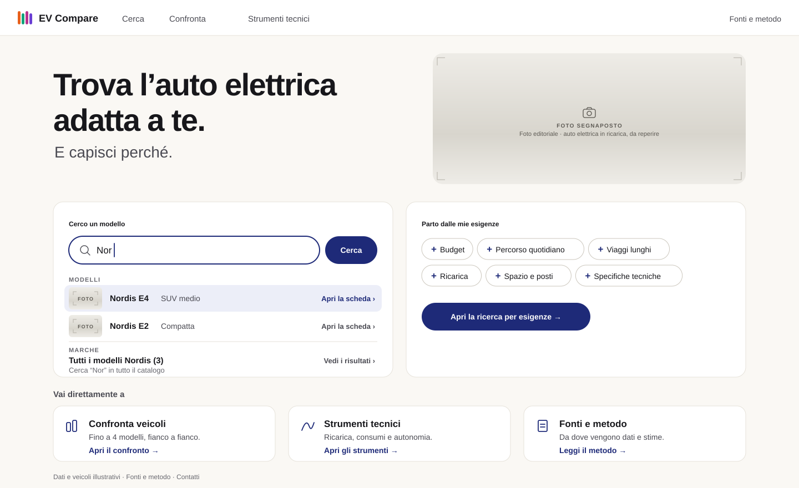

# Livrea Refined

_Iteration 2, variant A. Livrea's liveliness, calibrated for everyday use._

> Exploration history (M0.2). Merged into Livrea Consolidated in iteration 3. The selected visual identity of EV Compare is [Livrea Consolidated](../livrea-consolidated/README.md).

| Screen                              | File                                     |
| ----------------------------------- | ---------------------------------------- |
| Identity sheet                      | [`00-identity.svg`](00-identity.svg)     |
| Landing Page                        | [`01-landing.svg`](01-landing.svg)       |
| Vehicle Discovery — Active Criteria | [`02-discovery.svg`](02-discovery.svg)   |
| Comparison — Selected Vehicles      | [`03-comparison.svg`](03-comparison.svg) |
| DC charging curves                  | [`04-charging.svg`](04-charging.svg)     |

## Core idea

Keep what was liked in [Livrea](../livrea/README.md) (the vivid palette, the energy, a colour identity for compared vehicles) and remove what made it tiring: the black criteria column, full-height coloured columns, Archivo Black everywhere. The vivid colours are kept for vehicles, but shrink to small numbered marks; the interface gets its own accent and the product gets real signal colours. Tables and charts take Tavola's discipline (hairlines, aligned values, provenance, curve points) without its typography.

## Colour system

Three families with separate jobs. A colour from one family never does the job of another.

| Family    | Tokens                                                                                                            | Job                                                                                     |
| --------- | ----------------------------------------------------------------------------------------------------------------- | --------------------------------------------------------------------------------------- |
| Interface | Inchiostro `#17171B`, Pagina `#FAF8F4`, Bianco, Filo `#CBC6BC`; **Blu inchiostro `#1E2A78`**, Blu tenue `#ECEEF8` | Text, surfaces; actions, links, focus, active navigation, selected segments, hover rows |
| Vehicles  | 1 Mandarino `#E8601C`, 2 Smeraldo `#11A37A`, 3 Magenta `#B8338E`, 4 Viola `#6A3FD4`                               | Identity of a vehicle in the comparison, always with its number                         |
| Signals   | Informazione = Blu inchiostro on `#ECEEF8`; Attenzione `#8F5300` on `#FBF1DD`; Critico `#B3261E` on `#FBEAE8`     | States, always with an icon and words                                                   |

Contrast: Blu inchiostro on white 12.7:1; secondary text `#4A4A52` 8.8:1; notes `#68686F` 5.2:1 on the page; signal text on its tint 5.5–11:1; slot numbers on their colours 5.2–6.4:1 (ink on Mandarino and Smeraldo, white on Magenta and Viola).

The four vehicle colours pass the colour-vision validator on all pairs. Blue is deliberately not a vehicle colour: the interface accent is a dark blue, and keeping vehicle colours at mid lightness and high chroma separates them from it by lightness as well as by role.

Rules:

- A vehicle colour appears only with its number: badge, 3 px rule under a card photo, chip, chart line plus marker, dot on a scale.
- Vehicle colours never fill large areas and never colour text.
- Vehicles outside the comparison are neutral: no badge, no rule.
- Actions are never in a vehicle colour.
- Fit markers are neutral (blue check on a blue tint). Only a missed requirement uses the critical signal, and the overrun value ("€1.800 oltre il limite") is set in that colour next to an icon.

## Vehicle identity (section 5 of the brief)

- **Assignment:** a vehicle takes the lowest free slot (1–4) when it enters the comparison.
- **Removal:** frees the slot; the others keep their colour and number. Nobody is repainted.
- **Adding after a removal:** fills the freed slot, so the slot numbers stay 1–4 and colours stay stable for the vehicles already present (shown in the identity sheet).
- **Three or four vehicles:** four colours and four marker shapes (circle, square, triangle, diamond). Columns stay neutral; only the header badge carries colour, so four columns do not become four coloured bands.
- **Chart series:** colour + marker shape + direct label with the number. Readable without colour.
- **Not yet selected:** neutral card, "+ Aggiungi al confronto".
- **Single-vehicle analysis:** neutral (interface colours). If the vehicle is in the comparison, its badge appears next to the name as a reminder; charts of a single vehicle use the neutral ink line.
- **Coexistence with signals:** different families, different shapes (numbered badge vs icon), different lightness.

## Typography

**Schibsted Grotesk** (OFL), embedded in the SVGs. A news grotesk with some warmth and irregularity; less heavy and less loud than Archivo Black, but not a neutral UI sans.

- Headings 700: 56 (landing), 32 (page), 26 (results), 20 (sections), with tight tracking.
- Body and labels 400–600, 12–17.
- Tabular figures only on chart axes and in the stations table. Schibsted's tabular set also widens `.`, `,` and `:`, so it is not applied to prices or to values with decimals.

## Composition

- Light surfaces, white cards with a hairline border and 14–18 px radius, soft hierarchy. No black blocks.
- The criteria column is a white card; the open criterion is outlined in the accent.
- The comparison follows Tavola: hairline rows, values in one column per vehicle, provenance in a fixed column (glyph + word: ■ `costruttore`, ○ `stima`, ◆ `calcolo`).
- "Altre differenze" places both vehicles on one zero-based scale per row, using their numbered badges.
- The hover row (shown on "Bagagliaio") uses Blu tenue: the light-theme version of Notturno's lit row.

## Photography

Real photographs, integrated: top of result cards (330 × 156), comparison headers (300 × 128), thumbnails in the model search and near matches, one editorial image in the landing hero. Rounded like the cards, on a neutral light background, never under text. All images are currently **labelled placeholders**; see [`../photography.md`](../photography.md).

## Technical visualisation

- Vehicle lines 2.5 px in slot colour; markers on the manufacturer's curve points in the slot shape; linear interpolation between them, stated in a one-line key (from Tavola).
- The region above the station's power is hatched and labelled; Nordis E4's curve inside it is dotted (from Notturno's unlit band, in light form).
- The 10→80 % interval is a Blu tenue band, because it is a setting.
- Energy over time is shown in its hover state at 20 minutes: crosshair, ringed points, tooltip with both engine values.
- Results are cards with a slot-coloured edge, the badge, and the time at 52 px.

## Motion and interaction

Quiet: 150 ms fades and colour changes. Adding a vehicle draws the 3 px rule under the photo and the badge appears in the tray and in the navigation dot group. Hover in tables lights the row in Blu tenue; hover in charts shows the crosshair and tooltip. Focus is a 2 px Blu inchiostro outline.

## Strengths

- Comfortable for long sessions; the densest screens read almost like Tavola.
- A complete, explainable colour system with room for states and signals.
- Photographs fit the cards naturally and stay subordinate to information.
- Easiest of the two to implement and to extend to new screens.

## Limits and risks

- Less recognisable than the original Livrea. Personality rests on the vehicle colours, Schibsted and photography; without photos and without a selection (landing), the page is mostly neutral.
- The dark blue accent and the violet of slot 4 must stay apart in use (role and lightness keep them distinct, but they are both "blue-ish").
- Small marks carry identity: on mobile they need minimum sizes.
- Risk of drifting into a generic light UI if the vivid marks are used too timidly.

## Implementation considerations

- One self-hosted OFL family (variable, 400–900).
- Comparison slots as application state (lowest free slot); charts read colour and marker from the slot.
- Signals as tokens with paired tint, text and icon.
- Photography pipeline and fallback (labelled neutral placeholder) as in [`../photography.md`](../photography.md).
- Dark theme not designed; the three-family model transfers, values need re-stepping.
