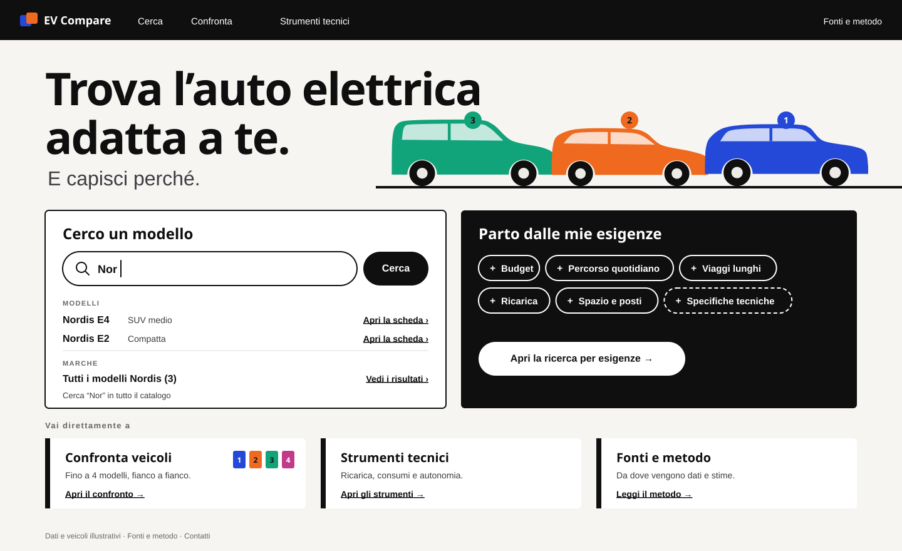

# Livrea

_Each vehicle in the comparison wears a colour that follows it everywhere._

> Exploration history (M0.2). Chosen in iteration 1 for further work; evolved into Livrea Refined and Livrea Expressive. The selected visual identity of EV Compare is [Livrea Consolidated](../livrea-consolidated/README.md).

| Screen                              | File                                     |
| ----------------------------------- | ---------------------------------------- |
| Identity sheet                      | [`00-identity.svg`](00-identity.svg)     |
| Landing Page                        | [`01-landing.svg`](01-landing.svg)       |
| Vehicle Discovery — Active Criteria | [`02-discovery.svg`](02-discovery.svg)   |
| Comparison — Selected Vehicles      | [`03-comparison.svg`](03-comparison.svg) |
| DC charging curves                  | [`04-charging.svg`](04-charging.svg)     |

This is the deliberately bold direction.

## Core idea and rationale

A _livrea_ is a racing livery: the colours that let you recognise a car at a glance. In EV Compare the hardest continuity problem is following the same vehicles from search to comparison to simulation. Livrea solves it with colour: when a vehicle enters the comparison it receives a slot colour and number (1 cobalt, 2 tangerine, 3 emerald, 4 magenta) and keeps them in the result card, the comparison tray, the navigation badge, the comparison column and the chart line.

Because colour does that job, it does nothing else. The interface itself is ink and white, heavy type and solid blocks. The result is loud and recognisable, but every colour on screen means "this vehicle".

## Palette and semantic roles

| Token       | Hex       | Role                                                          |
| ----------- | --------- | ------------------------------------------------------------- |
| Inchiostro  | `#0F0F10` | Text, primary actions, the criteria column, requirement chips |
| Bianco      | `#FFFFFF` | Cards and inputs                                              |
| Pagina      | `#F6F5F1` | Page background                                               |
| Pietra      | `#ECEBE6` | Neutral image fields, empty tracks                            |
| Grafite     | `#3D3D42` | Secondary text, vehicles outside the comparison               |
| Grigio note | `#66666D` | Notes (5.7:1 on white, 5.2:1 on page)                         |

| Livery      | Hex       | Tint      | Text on it   |
| ----------- | --------- | --------- | ------------ |
| 1 Cobalto   | `#2448D8` | `#E8ECFB` | white, 7.0:1 |
| 2 Mandarino | `#EF6A1F` | `#FDEEE4` | ink, 6.2:1   |
| 3 Smeraldo  | `#11A37A` | `#E3F4EE` | ink, 6.0:1   |
| 4 Magenta   | `#C23A8A` | `#F8E7F1` | white, 4.9:1 |

The four liveries pass the CVD validator on all pairs; emerald ↔ magenta sits in the 6–8 ΔE band for deuteranopia, which is acceptable only because every livery is always paired with its slot number. There are no other hues: fit, warnings and focus use ink, weight and shape.

## Typography and hierarchy

- **Archivo Black** for headings and key numbers: the headline at 72 px, the results count "3" at 96 px, prices at 28 px, charging times at 64 px.
- **Archivo** (500–800) for body, labels and values.

Hierarchy comes from size and weight jumps, not from colour. The main number of each block is its headline.

## Composition

- Strong figure–ground: a black criteria column against light results; a white search block against a black needs block on the landing.
- Comparison columns are tinted with their livery for the full height of the table, so the column stays identifiable while scrolling. The header block is solid livery colour.
- Rounded pills for chips, toggles and buttons; cards with a small 6 px radius. Pills are the only rounded shape and signal "interactive".

## Components

- **Criteria (on the black column):** requirement = solid white block; preference = dashed white outline. The open editor is a white panel with a thick slider and a pill toggle for Requisito / Preferenza.
- **Requirement fit on cards:** filled ink pills with a check, one per requirement. Preferences: check discs and text.
- **Comparison tray:** filled livery pills with slot numbers; free slots 3 and 4 shown as dashed circles.
- **Buttons:** filled ink pills; secondary 2 px outline pills; "Nel confronto" becomes a livery pill.
- **Provenance tags:** pills: `costruttore` filled graphite, `stima` dashed outline, `calcolo` solid outline. Fill and border differ, not only the word.
- **Navigation:** the comparison count is shown as the slot badges themselves.

## Vehicle representation

Flat silhouettes in the vehicle's livery on its tint; vehicles outside the comparison are graphite on stone. In the comparison header the silhouette turns white or ink to sit on the livery block. Silhouettes work for any vehicle without photography and make the colour assignment unmistakable. They are generic body styles, not models.

## Technical visualisation

- Thick 3.5 px lines in livery colours, with the slot number in a coloured end tag ("1 Nordis E4").
- The station limit is a bold dotted ink line with a black pill label.
- Nordis E4's curve above the station limit is a thin, faded livery line, labelled "senza il limite della colonnina".
- The 10→80 % interval is a light band.
- 20-minute values sit in livery-coloured callouts on the energy chart.
- Results above the charts are solid livery blocks with 64 px times.
- In "Altre differenze", livery bars from zero under each value show magnitude. They do not rank: for consumption the shorter bar is the lower value, not a better score.

## Motion and interaction

Colour assignment is the moment to animate: when a vehicle is added, the livery fills the "Nel confronto" pill and a slot badge flies to the navigation count (200–250 ms, ease-out). Removing a vehicle drains the colour. On chart hover, the hovered vehicle's line stays at full strength and the others fade to 30 %; the end tag follows the cursor. No decorative motion elsewhere.

## Strengths

- The most recognisable and the most original of the three.
- Colour has a product function: continuity of vehicles across activities, a stated goal of the vision.
- Comparisons with three or four vehicles stay readable: columns, chips and lines share one key.
- Approachable for buyers without technical knowledge; big numbers make outcomes immediate.

## Limits and risks

- Colour is spent on identity, so states and warnings must rely on shape and weight. Any later need for a status colour breaks the rule.
- Heavy type and solid blocks are tiring in long technical sessions; information density is lower than Tavola.
- Needs a strict assignment rule (see [`../ux-notes.md`](../ux-notes.md)): colours must stay with a vehicle when another is removed, and a fifth vehicle has no colour.
- Discovery cards outside the comparison look plainer than selected ones; that is intended, but the first screen without a selection is less colourful than this mock-up.
- Archivo Black's fallback (Arial Black) is wide; long names in 300 px columns need truncation rules.

## Implementation considerations

- Two OFL families, self-hostable.
- Livery assignment is application state (comparison slots), not styling: it must be part of the comparison selection model and survive navigation.
- Charts need series colours driven by slot, never by order in the dataset.
- Tinted full-height columns require a table layout where column backgrounds span sections; feasible with grid or with per-cell backgrounds.
- Dark mode: liveries need re-stepped values for dark surfaces; the black criteria column would need a different figure–ground device.
