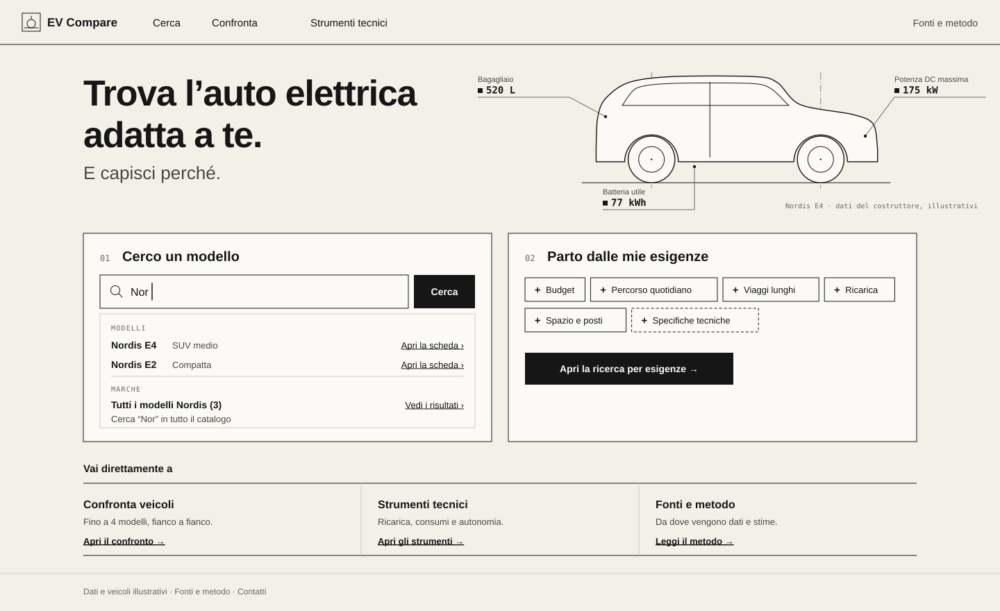

# Tavola

_The vehicle as an annotated technical drawing._

| Screen                              | File                                     |
| ----------------------------------- | ---------------------------------------- |
| Identity sheet                      | [`00-identity.svg`](00-identity.svg)     |
| Landing Page                        | [`01-landing.svg`](01-landing.svg)       |
| Vehicle Discovery — Active Criteria | [`02-discovery.svg`](02-discovery.svg)   |
| Comparison — Selected Vehicles      | [`03-comparison.svg`](03-comparison.svg) |
| DC charging curves                  | [`04-charging.svg`](04-charging.svg)     |

## Core idea and rationale

A _tavola_ is a technical drawing sheet. EV Compare promises precision and transparency; Tavola makes those visible. Data is drawn the way an engineer annotates a drawing: each value is placed on the object it describes and carries a mark for where it comes from. The landing shows one vehicle as a side elevation with three callouts (boot, usable battery, peak DC power), each with the manufacturer glyph. Nothing is decorative that is not also information.

The risk of an engineering look is coldness. Tavola counters it with warm paper instead of white, generous spacing, and plain language everywhere the wireframes already use it: the drawing sets the tone, the copy stays practical.

## Palette and semantic roles

| Token          | Hex       | Role                                                                                          |
| -------------- | --------- | --------------------------------------------------------------------------------------------- |
| Carta          | `#F3F0E8` | Page background                                                                               |
| Foglio         | `#FBFAF6` | Panels, cards, inputs                                                                         |
| Inchiostro     | `#161616` | Text, lines, primary actions (filled)                                                         |
| Grafite        | `#4A4741` | Secondary text (8.1:1 on paper)                                                               |
| Grafite chiara | `#6B675F` | Notes, axes, captions (4.9:1 on paper, 5.4:1 on sheet)                                        |
| Filo           | `#CFC9BC` | Hairlines, dividers; `#E4DFD3` for chart minor grid                                           |
| Vermiglio      | `#C8361B` | Signal: active navigation, focused criterion, comparison count, highlighted table row (4.6:1) |

Colour is almost absent by design. Vermilion is the only accent and never means good or bad.

Chart series: 1 ink, solid; 2 `#2251A3`, dashed; 3 `#C27A00`, dash-dot; 4 `#A63D7A`, dotted. Slots 2–4 pass the CVD validator on all pairs (6–8 ΔE band for 2↔4, legal because each slot also has its own line style and direct labels). Slot 1 is achromatic on purpose and relies on darkness and the solid line.

## Typography and hierarchy

- **IBM Plex Sans** for headings (600, 52 / 28 / 22 / 18), body and labels (400–600, 12–16).
- **IBM Plex Mono** for every figure (prices, kW, minutes, kWh), units, provenance tags and small-caps kickers (`REQUISITI`, `CRITERIO COLLEGATO`).

Monospaced figures align in columns without extra effort and visually separate data from prose. Sections in the comparison are lettered (A–D) like drawing zones; landing panels are numbered 01 and 02.

## Composition

- Hairline rules instead of cards where content is a list: the "Vai direttamente a" strip, "Approfondisci", the stations table.
- Boxes only for interactive elements and result units. Corners are square.
- The comparison table keeps a fixed provenance column at the right edge of the label column, as the wireframe specifies.
- Grid drawn only where it carries meaning: under vehicle drawings and in charts.

## Components

- **Criteria:** requirement = solid 1 px ink box; preference = dashed box (the baseline distinction, unchanged). The open editor gets a 3 px vermilion bar and a 1.5 px border. The slider has a ruled scale with every 50 kW labelled.
- **Buttons:** primary filled ink; secondary 1 px outline; links underlined.
- **Fit markers:** a check in a small square; a missed requirement is a circle with a minus.
- **Provenance tags:** glyph + word in mono: ■ `costruttore`, ○ `stima`, ◆ `calcolo`. The glyph alone stays readable in narrow columns.
- **Comparison selection:** chips and "Nel confronto" toggles show the line style the vehicle will have in charts (solid, dashed), linking discovery to the technical views without colour.

## Vehicle representation

Side elevations in a single ink weight, on a light grid, with wheel centre lines. Body styles differ (SUV, compact, MPV, wagon, sedan). The drawings are generic: no dimensions are written on them, because the data has none. In production each body style (or each model) needs a drawing; generic outlines are a valid fallback for missing images, which a photographic identity does not have.

## Technical visualisation

- Graph-paper grid: minor every 5 % / 10 kW, major every 20 % / 50 kW.
- The SoC interval being charged (10→80 %) is hatched, like a section in a drawing.
- **Provenance in the chart itself:** squares (Nordis) and diamonds (Aurora) mark the manufacturer's curve points; the line between them is the engine's linear interpolation. The legend says so in one line.
- The station limit is a dash-dot construction line. Where Nordis E4's curve exceeds 150 kW, its own curve is dotted and the effective power is solid, so "limitata dalla colonnina" is visible, not only written.
- Energy over time marks the 80 % end point and the 20-minute values from the engine.
- In "Altre differenze", a small scale from zero places both values on one axis per row. It shows magnitude without ranking.

## Motion and interaction

Minimal and mechanical: 120–160 ms linear transitions, no easing flourishes. Opening a criterion editor draws the vermilion bar from top to bottom. On chart hover, a vertical cursor line snaps to the nearest 1 % SoC or 1 minute and the values appear in mono next to the axis, like a reading taken from the drawing. Hovering a table row highlights it with the sheet colour and a vermilion edge (as in the stations table).

## Strengths

- Best density handling of the three: discovery and comparison read like well-set tables.
- Provenance is part of the visual language, not an add-on.
- Calm, credible, long-lived; unlikely to date quickly.
- Lowest implementation cost: system of rules and type, few assets.

## Limits and risks

- Can read as austere or "for engineers", which conflicts with the buyer audience if the copy and spacing drift.
- Personality depends on line drawings; stock photography would break the language.
- Little emotional pull; engagement relies on clarity and craft.
- The monospaced figures widen columns; four vehicles at 232 px need checking with long values ("20→100% in 5 h 36").

## Implementation considerations

- Two OFL font families, self-hostable. Plex Mono needs tabular figures only, which it has by construction.
- Hairlines at 1 px need care on fractional device pixel ratios (snap to the pixel grid).
- Charts: the language requires per-point markers, hatch patterns and construction lines; any SVG charting approach can do this, but defaults must be overridden.
- Vehicle drawings: an SVG outline per body style is cheap; per-model drawings are a content task.
- Dark mode is not designed. An "inverted drawing" (light lines on dark paper) is plausible but must be designed, not flipped.
